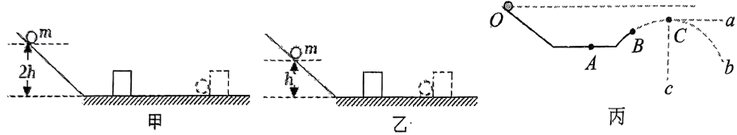

# Physics - 题目 2348

**ID**: 0d9cbe1d941240ee8cc6c842061efaee
**年级**: Grade 9
**难度**: Medium
**题型**: Experiment

## 题目
在探究“物体动能的大小与什么因素有关”的实验中。​​​​​​​‌小明同学让同一钢球分别从斜面不同高度由静止开始滚下，撞击木块。（1）该实验是通过观察木块移动的距离来判断（选填“钢球”或“木块”）动能大小的；（2）如图甲、乙所示的两次实验，是为了探究对动能大小的影响。这个结论可用来解释汽车（选填“超速”或“超载”）带来的危害；（3）如图丙，将小球从一个光滑斜槽轨道OAB的O点自由滚下，依次经过A、B两点到达C点（忽略空气阻力），设A、B两点的机械能分别为 $E{{}_{{\rm{A}}}}$ 和 $E{{}_{{\rm{B}}}}$ ，则 $E{{}_{{\rm{A}}}}$$E{{}_{{\rm{B}}}}$ （选填“＞”、“＝”或“＜”）。当小球从B点运动到最高点C时，假设小球所受的外力全部消失，则小球将。

## 解答

1. （1）实验中应用了转换法，通过观察木块被撞击后滑行的距离的大小来间接判断钢球动能的大小。
2. （2）由图甲、乙所示的两次实验知道，钢球的质量相同，下滑的高度不同，到达水平面时的速度不同，木块被推动的距离不同，因此两次实验是为了探究速度对动能大小的影响。
3. 上述实验可得出：物体的质量一定时，速度越大，动能越大。这个结论可用来解释汽车超速带来的危害。
4. （3）将小球从一光滑斜槽轨道（OAB）O点自由滚下（图丙），依次经过A、B两点到达C点（忽略空气阻力），设A、B两点的机械能分别为E_{A}和E_{B}，实验过程不存在能的损耗，则E_{A}=E_{B}
5. 当小球从B点做斜抛运动到达最高点C时，只在水平方向上有速度，此时假设小球所受的外力全部消失，则小球将做匀速直线运动，故A符合题意，BCD不符合题意。

## 知识点

**中文**:
  - 探究影响物体动能大小因素的实验

**English**:
  - Experiment: Factors Affecting Kinetic Energy

---
