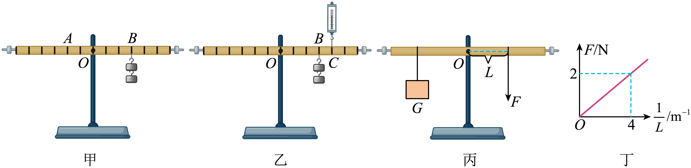

# Physics - 题目 767

**ID**: 114f2c79b8a0414ba3750a0c89f0afd2
**年级**: Grade 9
**难度**: Medium
**题型**: Experiment

## 题目
在探究杠杆平衡条件的实验中：（1）小丽把杠杆支在支架上，若杠杆左端下沉，可调节左端的平衡螺母向端移动，使杠杆在水平位置平衡，目的是；（2）如甲图所示，在杠杆右边B处挂两个相同的钩码，要使杠杆仍在水平位置平衡，应在杠杆左边A处挂个相同的钩码；（3）如乙图所示，用弹簧测力计在C处竖直向上拉，当弹簧测力计逐渐向右倾斜时，杠杆仍然在水平位置平衡，弹簧测力计的示数F（选填“变大”、“不变”或“变小”），原因是。​​​​​​​‌（4）如丙图所示，在杠杆左端某一固定位置挂一个重力 $G=2.5{\rm{N}}$ 的物体，在杠杆右端不同位置处施加不同的竖直向下的力F，保证杠杆处于平衡状态。根据多次测量的F、L数据，画出如图丁所示图线，由图丙可得出杠杆平衡的条件是F与L成比，结合杠杆平衡条件，可求出重力G的力臂是${\rm{m}}。$

## 解答

1. （1）在“探究杠杆的平衡条件”实验中，应先调节杠杆两端的平衡螺母，使杠杆在水平位置平衡，这样做是为了便于测量力臂；如发现杠杆左端下沉，应将左端的平衡螺母向右调节。
2. （2）设杠杆的分度值为L，一个钩码的重为G，根据杠杆平衡条件 $F{{}_{1}}L{{}_{1}}=F{{}_{2}}L{{}_{2}}$ 得
3. $nG\times 2L=2G\times 3L$
4. 解得 $n=3$ ，则应在杠杆左边A处挂3个相同的钩码。
5. （3）当弹簧测力计竖直向上拉动杠杆，杠杆在水平位置平衡，力臂为OC，当弹簧测力计逐渐向右倾斜时，力臂变小，阻力和阻力臂不变，拉力F会变大。
6. （4）如乙图，F和 $\frac {1}{L}$ 成正比， $\frac {F}{\frac {1}{L}}$ 为定值，所以FL为定值，可以推断 $F-L$ 成反比。
7. 因为 $\frac {1}{L}=4{\rm{m}}{^{-1}}$ ，所以 $L=0.25{\rm{m}}$ ，根据杠杆平衡条件得： $GL^{′}=FL$ ，则有
8. $2.5{\rm{N}}\times L^{′}=2{\rm{N}}\times 0.25{\rm{m}}$
9. 解得 $L^{′}=0.2{\rm{m}}$ 。

## 知识点

**中文**:
  - 探究杠杆的平衡条件实验

**English**:
  - Experiment: Equilibrium Conditions of Levers

---
