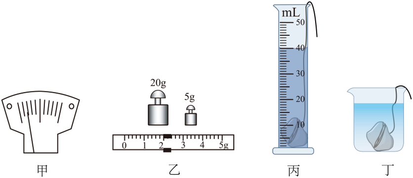

# Physics - 题目 1983

**ID**: 11b9650ab42a4172a73361d6a1a507e4
**年级**: Grade 9
**难度**: Medium
**题型**: Experiment

## 题目
某物理兴趣小组进行了鹅卵石密度的测量。​​​​​​​‌（1）小明在调节天平平衡时，将游码移动到标尺左端的零刻度线后，发现指针如图甲所示，则接下来应向（选填“左”或“右”）调节平衡螺母；（2）小明用天平称量鹅卵石的质量时，在最小的砝码放入右盘后，指针由分度盘中央刻度线的左侧转至右侧。此时小明取下最小的砝码，下一步操作是（选填“A”或“B”）；

## 解答

1. （1）由图可知，天平指针偏向左边，则应该把平衡螺母向右调节。
2. （2）当加入最小砝码时，指针偏右，说明砝码质量偏大，此时应取下最小砝码，适当向右移动游码直到横梁平衡，故B符合题意，A不符合题意。
3. （3）由图乙可知，鹅卵石的质量 $m=20{\rm{g}}+5{\rm{g}}+2{\rm{g}}=27{\rm{g}}$ ，由图丙可知，量筒中水的体积
4. $V{{}_{1}}=30{\rm{m}}{\rm{L}}$ ，量筒中水和鹅卵石的总体积 $V{{}_{2}}=40{\rm{m}}{\rm{L}}$ ，则鹅卵石的体积 $V=V{{}_{2}}-V{{}_{1}}=40{\rm{m}}{\rm{L}}-30{\rm{m}}{\rm{L}}=10{\rm{c}}{\rm{m}}{^{3}}$ ，鹅卵石的密度 $ρ=\frac {m}{V}=\frac {27{\rm{g}}}{10{\rm{c}}{\rm{m}}{^{{{3}}}}}=2.7{\rm{g}}{\rm{/}}{\rm{c}}{\rm{m}}{^{{{3}}}}=2.7\times 10{^{3}}{\rm{k}}{\rm{g}}{\rm{/}}{\rm{m}}{^{3}}$ 。
5. （4）⑤加入水的质量为 $m{{}_{水}}=m{{}_{3}}-m{{}_{2}}$ ，加入水的体积为 $V{{}_{水}}=\frac {m{{}_{水}}}{ρ{{}_{水}}}=\frac {m{{}_{3}}-m{{}_{2}}}{ρ{{}_{水}}}$ ，鹅卵石的体积为 $V=V{{}_{水}}=\frac {m{{}_{3}}-m{{}_{2}}}{ρ{{}_{水}}}$ ，鹅卵石的密度为 $ρ=\frac {m}{V}=\frac {m{{}_{1}}}{\frac {m{{}_{3}}-m{{}_{2}}}{ρ{{}_{水}}}}=\frac {m{{}_{1}}ρ{{}_{水}}}{m{{}_{3}}-m{{}_{2}}}$ ，⑥将鹅卵石从水中取出后，向烧杯内加水至标记处，将鹅卵石从水中取出时，沾了水，对测算鹅卵石体积没有影响，那么该鹅卵石密度的测量值与真实值相比不变。

## 知识点

**中文**:
  - 固体密度的测量实验
  - 特殊方法测密度

**English**:
  - Experiment: Measuring Density of Solids
  - Special Methods for Measuring Density

---
