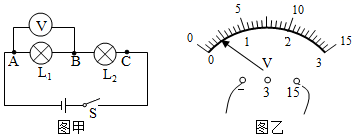

# Physics - 题目 1918

**ID**: 12b8f94b2a6a4ba2bc540c9d06087beb
**年级**: Grade 9
**难度**: Medium
**题型**: Experiment

## 题目
小希和小聪一起进行“探究串联电路的电压关系”的实验。​​​​​​​‌(1)为了使探究得出的结论具有普遍意义。L_{1}、L_{2}应该先选择灯泡规格相同，再选择（选填“相同”或“不相同”）的小灯泡。这样做的目的是。(2)小希根据图甲连接好电路，闭合开关，发现L_{1}、L_{2}均不发光，电压表有示数且大小接近电源电压，则电路中出现的故障可能是L_{1}发生了（选填“短路”或“断路”）。(3)小聪帮助小希排除故障后，重新闭合开关，电压表示数如图乙所示，为了使测量结果更准确，接下来他应该。(4)测出L_{1}两端的电压后，小希断开开关，准备拆下电压表，改装在B、C之间。小聪认为这样操作太麻烦，只需将与A点相连的导线改接到C点即可。小希认为小聪的办法是错误的，原因是。

## 解答

1. (1)[1][2]为了使探究得出的结论具有普遍意义，避免结果的偶然性，使结论具有普遍性，L_{1}、L_{2}应该先选择灯泡规格相同，再选择不相同的小灯泡。
2. (2)[3]小希根据图甲连接好电路，闭合开关，发现L_{1}、L_{2}均不发光，电压表有示数且大小接近电源电压，则电路中出现的故障可能是L_{1}发生了断路，造成电压表串联在电路中。
3. (3)[4]小聪帮助小希排除故障后，重新闭合开关，电压表示数如图乙所示，电压表接入大量程，读数为2V，不超过小量程的上限3V，为了使测量结果更准确，接下来他应该更换小量程。
4. (4)[5]小聪的办法是错误的，原因是按此操作下，电压表正负接线组接反。

## 知识点

**中文**:
  - 探究串、并联电路中的电压规律实验

**English**:
  - Experiment: Voltage Laws in Series/Parallel

---
