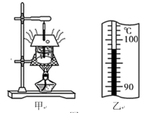

# Physics - 题目 188

**ID**: 1657a8268b2a4950a30cf101ba2a473e
**年级**: Grade 9
**难度**: Medium
**题型**: Experiment

## 题目
小明用如图甲所示的装置观察水沸腾时的现象。​​​​​​​‌（1）如图乙所示为水沸腾时温度计的示数，则水的沸点为℃，如果水沸腾后用酒精灯对烧杯持续加热，则水的温度将（选填“持续升高”或“保持不变”）。（2）实验中不能用盖子将烧杯内的水密封起来，需在盖子上留有一个小孔使杯内气体与外界大气相通，这样做的目的是。

## 解答

1. (1)[1][2]由图可知，温度计上10℃之间有10个小格，所以一个小格代表的温度是1℃，即此温度计的分度值为1℃，此时的温度为98℃；水在沸腾过程中不断吸热，但温度保持不变。
2. (2)[3]水的沸点随气压的增大而升高。在盖子上留有一个小孔使杯内气体与外界大气相通，这样做的目的是使杯内水面上方的气体压强保持不变，水的沸点也不会改变。

## 知识点

**中文**:
  - 探究水的沸腾实验

**English**:
  - Experiment: Boiling of Water

---
