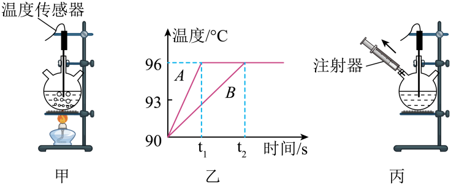

# Physics - 题目 2336

**ID**: 18190a8beee54c479d1b55d5aef4fb1c
**年级**: Grade 9
**难度**: Medium
**题型**: Experiment

## 题目
小明利用如图甲所示的三颈烧瓶做水的沸腾实验，当水温接近90℃时，每隔0.5min记录一次温度，并绘制出如图乙所示的水温随时间变化关系的图像。​​​​​​​‌（1）如图甲所示，观察烧瓶内气泡可判断是水沸腾（选填“前”或“时”）的现象；（2）图乙中，图像A、B是某班两个实验小组的同学根据实验数据作出的图像。由图像可知，此实验中水的沸点为℃，水沸腾时需要吸热，温度。他们用相同的装置做该实验，A、B图像不同的原因是；（3）接下来撤下酒精灯，小明将三颈烧瓶的瓶口全部用塞子密封住，然后向外拉动注射器的活塞，如图丙所示，发现烧瓶中的水再次沸腾，这是因为。

## 解答

1. （1）水沸腾前，因为底部温度高，气泡膨胀，但上升过程中水温降低，气泡内水蒸气液化，气泡变小则气泡在上升过程中会逐渐变小；水沸腾时，水温均匀，气泡上升时水蒸气不断增多，气泡膨胀变大，气泡在上升过程中会逐渐变大。 图甲中气泡上升变大，可判断是水沸腾时的现象。
2. （2）从图乙中可以看出，水的温度在达到某一值后保持不变，这个值就是水的沸点。由图可知，水的沸点为96℃；图像A、B的沸点均为96℃。则水沸腾时需要吸热，但温度保持不变；A、B图像的初温和末温均相同，图像不同主要表现为水温上升的快慢不同，原因是水的质量不同造成的。
3. （3）撤下酒精灯后，水不再从热源吸热，但将三颈烧瓶的瓶口密封并向外拉动注射器的活塞，会使烧瓶内的气压降低。 水的沸点与气压有关，气压降低时，水的沸点也会降低。 因此，当气压降低到一定程度时，水的沸点会低于当前水温，水会再次沸腾。

## 知识点

**中文**:
  - 探究水的沸腾实验

**English**:
  - Experiment: Boiling of Water

---
