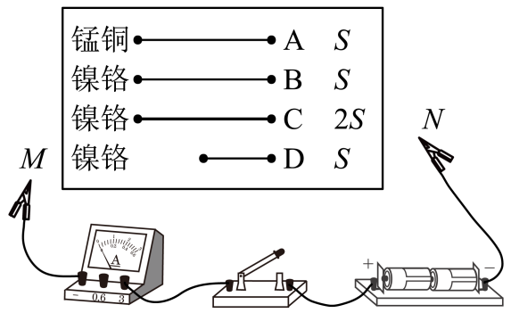

# Physics - 题目 423

**ID**: 1c1f7fae688442c69ee4b73a387bf67e
**年级**: Grade 9
**难度**: Medium
**题型**: Experiment

## 题目
小倩用如图所示的器材探究影响导体电阻大小的因素，实验板上固定了四根金属丝。​​​​​​​‌A、B、C的长度均为1m，D的长度为0.5m；A、B的横截面积相同，材料不同；B、C的材料相同，但横截面积不同；B、D的材料和横截面积都相同。探究导体的电阻大小与导体长度是否有关，应选用和两段金属丝接入M、N两点间。

## 解答

1. 探究导体电阻大小与导体长度是否有关，根据控制变量法，应控制导体的材料、横截面积相同，长度不同，所以应选用B和D两段金属丝接入M、N两点间。

## 知识点

**中文**:
  - 影响导体电阻大小因素的探究实验

**English**:
  - Experiment: Factors Affecting Resistance

---
