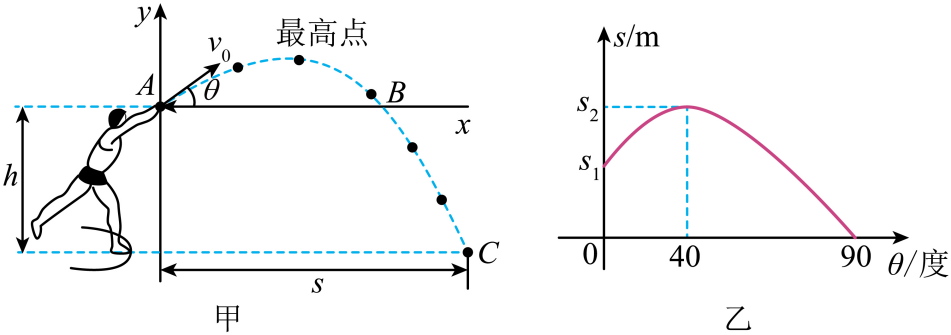

# Physics - 题目 1658

**ID**: 1f4750d61d7d45379da72007e3b1c0c5
**年级**: Grade 9
**难度**: Medium
**题型**: Experiment

## 题目
小明和同学们在操场上练习投掷实心球时，针对“如何将实心球投掷的更远”这一问题，大家展开了激烈讨论。​​​​​​​‌图甲是实心球出手后的运动轨迹示意图 ${\rm ，}v{{}_{0}}$ 是实心球离开手时的初速度 ${\rm ，}θ$ 是实心球出手后的运动方向与水平方向的夹角，又称投掷角度，h是实心球初始高度。大家猜想 $v{{}_{0}}$ 、 $θ$ 、h都会影响实心球投掷距离s。（1）实心球在最高点时，如果不受任何外力，将会（2）同学们用足球弹射装置和足球来模拟运动员投掷实心球，图乙是他们得到的投掷距离s随投掷角度 $θ$ 变化的图像，本实验中他们需要控制足球的相同。根据图像，你能得到什么规律：；（3）根据以上探究，为了将实心球投掷的更远，请你为小明提出一点建议：。

## 解答

1. （1）实心球在最高点时仍有速度，如果不受任何外力，由牛顿第一定律可知，将会做匀速直线运动。
2. （2）根据控制变量法，要探究投掷距离s与投掷角度 $θ$ 变化的关系，要控制足球的初速度和初始高度相同。
3. 由图可知，在足球的初速度和初始高度相同的情况下，当 $θ<40{^{\circ }}$ 时，投掷距离s随投掷角度 $θ$ 的增大而增大；当 $θ>40{^{\circ }}$ 时，投掷距离s随投掷角度 $θ$ 的增大而减小；当 $θ=40{^{\circ }}$ 时，投掷距离s有最大值。
4. （3）由（2）可知，在足球的初速度和初始高度相同的情况下 ${\rm ，}θ=40{^{\circ }}$ 时，投掷距离s有最大值，所以为了将实心球投掷的更远，可以将实心球沿 $θ=40{^{\circ }}$ 的角度投出。

## 知识点

**中文**:
  - 牛顿第一定律的理解与应用
  - 科学探究过程及实验方法

**English**:
  - Understanding and Application of Newton's First Law
  - Scientific Inquiry Process and Experimental Methods

---
