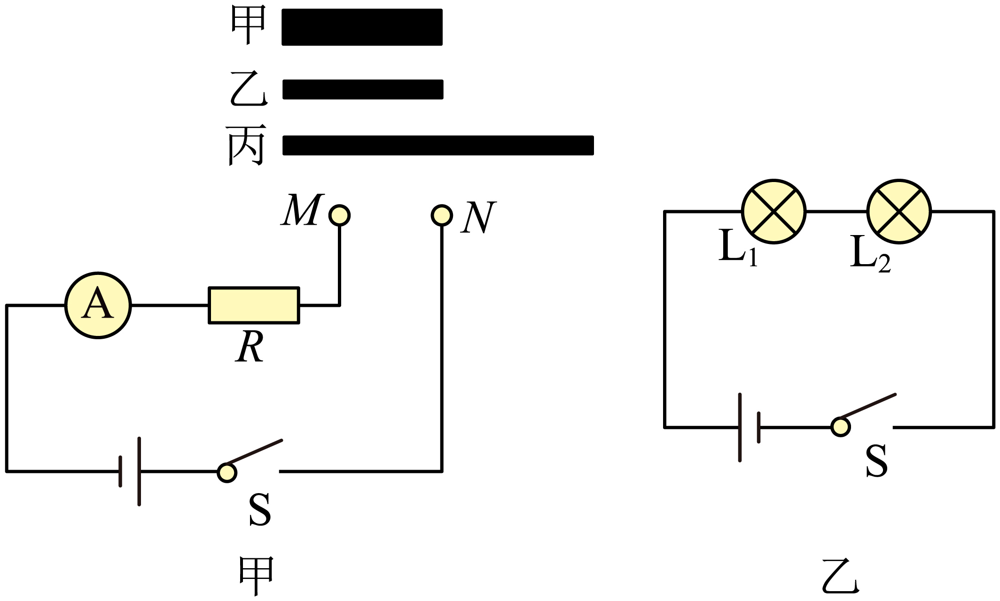

# Physics - 题目 438

**ID**: 20b71cb8d92e48ff93369bec274bb047
**年级**: Grade 9
**难度**: Medium
**题型**: Experiment

## 题目
小聪同学利用图甲的电路图，探究“导体电阻的大小与其横截面积的关系”，图中甲、乙、丙是镍铬合金丝，甲、乙长度相同，乙、丙粗细相同。​​​​​​​‌（1）实验中，根据可判断接入M、N两点间电阻的大小；（2）在图甲中，小聪应该选择两根电阻丝来探究导体电阻大小与导体横截面积的关系；（3）如图乙所示电路图，闭合开关S后，发现两灯泡均不亮，其中一个灯泡损坏。现提供导线、电压表，请自选上述器材进行故障检测，请在图中画出检测方法并写出检测时的实验现象及实验结论；检测电路实验现象实验结论（4）在图乙中，可以通过灯泡亮暗反映电功率的大小，请将实验思路过程补充完整。能量转换器材现象判断方法电能转化为选用两只的小灯泡灯泡亮暗不同灯泡亮的比灯泡暗的电功率大

## 解答

1. （1）根据欧姆定律，实验中，可根据电流表示数大小判断接入M、N两点间电阻的大小。
2. （2）探究导体电阻大小与导体横截面积的关系，根据控制变量法，应选择只有横截面积不同的甲、乙两根电阻丝。
3. （3）图中 ${\rm{L}}{{}_{1}}$ 、 ${\rm{L}}{{}_{2}}$ 串联，两灯泡均不亮，其中一个灯泡损坏，则是其中一个灯泡发生断路。将一根导线并联在 ${\rm{L}}{{}_{1}}$ 两端，若L_{2}亮，说明 ${\rm{L}}{{}_{2}}$ 完好，则L_{1}断路，若L_{2}不亮，则L_{2}断路。
4. （4）小灯泡工作时发光发热，将电能转化为内能和光能。
5. 图中 ${\rm{L}}{{}_{1}}$ 、 ${\rm{L}}{{}_{2}}$ 串联，电流相同，则应选择阻值不同而发光原理相同的两只小灯泡，根据 $P=I{^{2}}R$ ，两只小灯泡的实际功率不同，可以通过灯泡亮暗反映电功率的大小。

## 知识点

**中文**:
  - 影响导体电阻大小因素的探究实验

**English**:
  - Experiment: Factors Affecting Resistance

---
