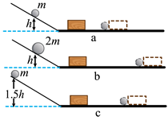

# Physics - 题目 1175

**ID**: 210a090a4a9c45c8bb88206d6eef019a
**年级**: Grade 9
**难度**: Medium
**题型**: Experiment

## 题目
如图所示为“探究影响动能大小的因素”三次实验图a、b、c，用质量分别为m和2m的两个小球分别从斜面上由静止滚下，并撞击放在水平木板上的同一木块，使木块滑动，木块滑动一段距离后分别停止在不同的位置（如虚线所示）；请回答：（1）小球的动能是由转化而来的；（2）在本实验中，是由反映小球的动能大小的；（3）要探究小球动能与速度的关系，应分别比较两次实验；（4）比较a和b，说明小球的动能随质量的增加而。​​​​​​​‌

## 解答

1. （1）[1]实验中，小球从高处滑下，小球的重力势能转化为动能。
2. （2）[2]实验中通过比较木块滑动的距离来反映小球动能的大小，用到了转换法。
3. （3）[3]探究小球的动能与速度的关系，应控制质量相同，速度不同，应使质量相同的小球从不同的高度滚下，故选a、c两图。
4. （4）[4]比较a、b两图进行的实验，质量不同的小球从相同高度滚下，质量大的小球推动木块运动的距离远，故结论为：当速度相同时，小球的质量越大动能越大。

## 知识点

**中文**:
  - 探究影响物体动能大小因素的实验

**English**:
  - Experiment: Factors Affecting Kinetic Energy

---
