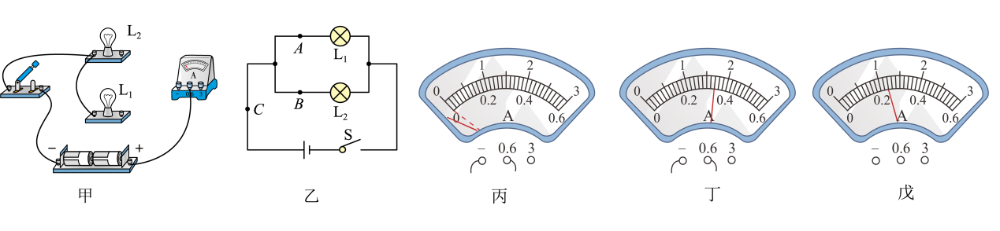

# Physics - 题目 1802

**ID**: 26f75a268d8a4d8f8a2d4695f868d898
**年级**: Grade 9
**难度**: Medium
**题型**: Experiment

## 题目
小明在进行“探究并联电路电流规律”的实验，图乙是实验的电路图。​​​​​​​‌（1）请将图甲实物图补充完整，连接完成后电流表只测通过灯L_{1}的电流；（2）实验时应该选用规格（选填“相同”或“不同”）的小灯泡；（3）闭合开关S前，发现电流表指针向“0”刻度的左侧偏转，如图丙所示，原因是；（4）改正后，应先将电流表接在A处，闭合开关S后，观察到灯L_{2}发光，但灯L_{1}不发光。电流表的示数为零，电路可能存在的故障是灯L_{1}（选填“短路”或“断路”）（5）排除故障后，他在测量A处的电流时，电流表的示数如图丁所示，则电流表的示数为A。测量C处的电流时，电流表的示数如图戊所示，则通过灯L_{2}的电流为A；（6）小明将电流表分别接入图乙电路中A、B、C三点处，闭合开关S，测出了一组数据并记录在表格中，立即得出了并联电路的电流规律，请你指出实验应改进的地方：。

## 解答

1. （1）由题意可知两灯应并联，电流表测 ${\rm{L}}{{}_{{{1}}}}$ 的电流，则电流表应串联在 ${\rm{L}}{{}_{{{1}}}}$ 的支路中。
2. （2）为得出普遍性的规律，实验中应该选择规格不同的小灯泡。
3. （3）闭合开关前，发现指针如图丙向“ $0$ ”刻度的左侧偏转，说明电流表没有校零，他应将电流表校零。
4. （4）闭合开关后，发现灯 ${\rm{L}}{{}_{{{2}}}}$ 亮，灯 ${\rm{L}}{{}_{{{1}}}}$ 不亮，说明干路和 ${\rm{L}}{{}_{{{2}}}}$ 支路完好，则该电路可能出现的故障是电流表或 ${\rm{L}}{{}_{{{1}}}}$ 断路。
5. （5）图丁中电流表的量程为 $0～0.6{\rm{A}}$ ，分度值为 $0.02{\rm{A}}$ ，电流大小为 $0.34{\rm{A}}$ 。电流表测量 $C$ 处的电流时，即为干路电流，比较丁和戊的指针偏转角度，可判断图戊中电流表选择的是大量程，则读数为 $1.2\mathrm A$ ，根据并联电路电流规律求出通过灯 ${\rm{L}}{{}_{{{2}}}}$ 的电流大小为 $1.2{\rm{A}}-0.34{\rm{A}}=0.86{\rm{A}}$ 。
6. （6）只根据一组数据得出结论有偶然性，为得出普遍性的结论，要换用不同规格的小灯泡进行多次实验。

## 知识点

**中文**:
  - 探究串、并联电路的电流规律实验

**English**:
  - Experiment: Current Laws in Series/Parallel

---
