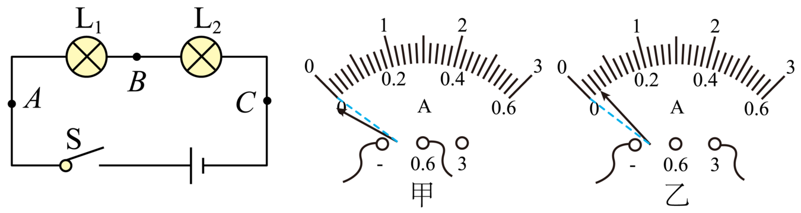

# Physics - 题目 61

**ID**: 2932780318a043cbb562ba8c778829b9
**年级**: Grade 9
**难度**: Medium
**题型**: Experiment

## 题目
如图是小明探究串联电路电流特点的实验电路图：（1）小明最好选择两个小灯泡的规格应该是的；（填“相同”或“不相同”）（2）小明连电路时把一只开关和两个小灯泡连接后，刚将线路两端接到电源两极，L_{2}就亮了，但L_{1}没亮．他在实验操作中不当之处是：。​​​​​​​‌实验时L_{1}没亮的原因可能是；

## 解答

1. （1）为了得到普遍规律，应选择两个小灯泡的规格应该是不同的．
2. （2）连接电路时，开关应是断开的，小明连电路时把一只开关和两个小灯泡连接后，刚将线路两端接到电源两极，L_{2}就亮了，但L_{1}没亮。他在实验操作中不当之处是：连接电路时开关没有断开。
3. 由于灯L_{1}与 L_{2}是串联，L_{2}亮了，但L_{1}没亮，说明电路出现了短路，实验时L_{1}没亮的原因可能是L_{1}灯座处可能短路了。故ABD不符合题意，C符合题意。
4. （3）由三组数据可以看出串联电路中，A、B、C三处的电流是相等的：可得出结论：串联电路中电流处处相等。
5. （4）由欧姆定律 $I=\frac {U}{R}$ 可知，电流的大小与电压和电阻有关，所以，他获得三组不同电流值的方法是：换了不同规格的小灯泡或改变电源电压。
6. （5）使用电流表时，要选择合适的量程且电流从电流表的“+”接线柱流入，“-”接线柱流出，电流表指针摆动分别出现了如图甲、乙所示的两种情况。甲：电流表的正负接线柱接反了；乙：电流表的量程选取得太大了。

## 知识点

**中文**:
  - 探究串、并联电路的电流规律实验

**English**:
  - Experiment: Current Laws in Series/Parallel

---
