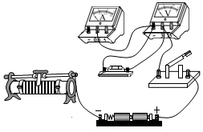

# Physics - 题目 847

**ID**: 29d6db8bb41e41ed8fc50d2ff9225d6b
**年级**: Grade 9
**难度**: Medium
**题型**: Experiment

## 题目
在探究电流与电压关系的实验中，已有器材∶干电池､电压表､电流表､滑动变阻器､开关､导线和阻值不同的定值电阻若干个｡(1)请你用笔画线代替导线，将图中的电路连接完整｡要求滑片向右滑动时，变阻器连入电路的电阻变大｡(2)实验时，闭合开关，将滑片移动到某位置，记下电压表和电流表的示数｡接下来的操作是｡​​​​​​​‌

## 解答

1. (1)[1]滑片向右滑动时，变阻器连入电路的电阻变大，导线应接滑动变阻器左下方，如图所示。
2. (2)[2]探究电流与电压关系，要保持电阻不变，将滑片移动到某位置，记下电压表和电流表的示数之后，接下来的操作应该直接将滑片移动到另外几个位置，分别记下电压表和电流表的示数，故选B。
3. (3)[3]由表可知，电压每增加0.3V，电流就增加0.8A左右，因此，通过定值电阻的电流与其两端的电压时成正比的。
4. (4)[4]只用一只定值电阻实验得到结论可能具有偶然性，因此要多换几只定值电阻在实验，同学这个建议科学合理｡通过多组实验，实验结论更具科学性、普遍性，避免了偶然性｡

## 知识点

**中文**:
  - 电流与电压关系的探究实验

**English**:
  - Experiment: Relationship between Current and Voltage

---
