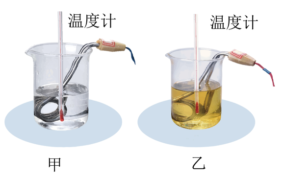

# Physics - 题目 1946

**ID**: 2ac460dbbbc14d10856f9dd26f64279d
**年级**: Grade 9
**难度**: Medium
**题型**: Experiment

## 题目
在探究“不同物质吸热能力”的实验中，实验装置如图甲、乙所示。​​​​​​​‌加热时间/min01234甲的温度/℃3034384246乙的温度/℃1018263442（1）实验中应取（选填“质量”或“体积”）相同的甲、乙两种液体，分别倒入相同的烧杯中，使用规格相同的电加热器加热；实验中通过（选填“升高的温度”或“加热时间”）来比较甲和乙两种液体吸收热量的多少。（2）小明认为在两种液体都不沸腾的情况下，要使甲和乙升高相同的温度然后进行比较甲、乙吸热能力，小红认为在两种液体都不沸腾的情况下，要加热相同的时间然后进行比较甲、乙吸热能力，你认为可行的是（选填“小明”“小红”或“都可行”）。（3）实验数据如图所示，液体的吸热能力强（选填“甲”或“乙”），如果要在甲、乙两种液体中选一种液体做为冷却剂，你认为（选填“甲”或“乙”）液体较为合理。（4）下列选项中与本实验研究物质特性有关的是：。

## 解答

1. （1）根据控制变量法得，实验中应取质量相同的甲、乙两种液体，分别倒入相同的烧杯中，使用规格相同的电加热器加热，加热器加热相同时间时，液体吸收的热量相同，则根据转换法，实验中通过加热时间来比较甲和乙两种液体吸收热量的多少。
2. （2）在两种液体都不沸腾的情况下，小明认为要使甲和乙升高相同的温度然后进行比较（加热的时间），小红认为要加热相同的时间然后进行比较（升高的温度），根据比较吸热能力的2种方法，两种方法都可行。
3. （3）由表格中数据得，质量相同的甲乙，加热1min吸收相同的热量后，甲升高温度较少，所以甲液体的吸热能力强；如果要在甲、乙两种液体中选择一种液体作为冷却剂，由于甲的吸热能力较强，相同情况下，升高相同的温度，甲吸收的热量多，甲液体作为冷却剂较为合理。
4. （4）A．夏天室内洒水降温，利用水蒸发吸收热量，故A不符合题意；
5. B．冬季暖气片用水作为散热介质，是因为水的比热容较大，相同情况下，水可以吸收较多的热量，故B符合题意；
6. C．用冰袋为病人退烧是由于冰可以吸收皮肤表面的热量，降低皮肤表面温度，故C不符合题意；
7. D．制冷剂在空调内部的蒸发器里面汽化，汽化要吸热，使空调蒸发器的温度降低，室内的水蒸气遇到温度低的冷凝器会发生液化现象，空调压缩机是利用制冷剂发生物态变化方法降温的，利用空调降温与比热容无关，故D不符合题意。

## 知识点

**中文**:
  - 物质的比热容探究实验

**English**:
  - Experiment: Investigating Specific Heat Capacity

---
