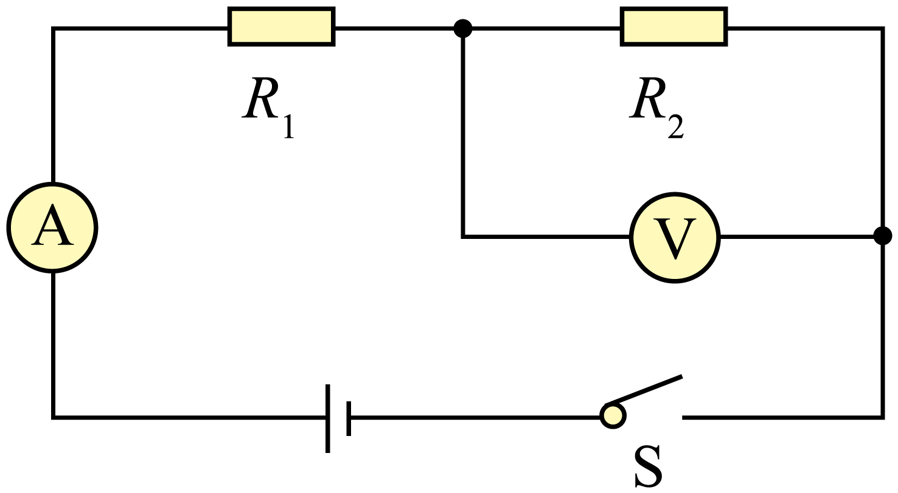

# Physics - 题目 856

**ID**: 2b757ff268384b3dac7b1e98edfdc513
**年级**: Grade 9
**难度**: Medium
**题型**: Experiment

## 题目
某小组同学按图所示的电路图连接电路，闭合开关，电流表、电压表示数均大于零。​​​​​​​‌他们讨论后认为根据上述现象无法确定电路中是否存在故障。（1）甲同学思考后认为用一个阻值与 $R{{}_{2}}$ 不同的完好电阻 $R$ 替换 $R{{}_{2}}$ ，根据替换前后（选填“电压表”“电流表”或“任意一个电表”）的示数变化情况就能判断电路是否存在故障。请写出他的判断方法；（2）乙同学思考后认为用一个完好的电阻 $R$ 替换 $R{{}_{1}}$ ，也可以判断电路是否存在故障，但电阻 $R$ 的阻值需要满足一定条件。下列符合条件的选项有。

## 解答

1. （1）由图知道，两个电阻串联，电压表测量R_{2}两端的电压，根据题意知道，没有替换前电流表示数均大于零，说明电路的若有故障，则应是短路，不会是断路；电压表示数均大于零，则说明如果短路则应是 $R{{}_{1}}$ 。所以，当用一个阻值与 $R{{}_{2}}$ 不同的完好电阻 $R$ 替换 $R{{}_{2}}$ ，根据串联分压原理知道，此时电压表示数应变化，若电压表示数不变，则说明电路中有故障，应是 $R{{}_{1}}$ 短路。而无论电阻 $R{{}_{1}}$ 是否短路，用一个阻值与 $R{{}_{2}}$ 不同的完好电阻 $R$ 替换 $R{{}_{2}}$ 后，电流表的示数都有变化，所以不能用电流表判断电路是否存在故障。
2. （2）若定值电阻R_{1}短路，用R替换R_{1}时，由电阻的串联可知电路的总电阻将变大，则由欧姆定律可知电流表A的示数将变小；若定值电阻R_{2}短路，用R替换R_{1}时，如果R等于R_{1}，则电流表A的示数不变；如果R大于R_{1}，由欧姆定律知道，电流表A的示数将变小；如果R小于R_{1}，由欧姆定律知道，电流表A的示数将变大；综上可知，如果选用的电阻R大于R_{1}，当出现电流表A的示数变小时，可能是R_{1}短路，也可能R_{2}短路，则利用该电阻不能准确判断电路故障；所以，选用的电阻R的阻值应小于或等于R_{1}，才能根据电流表的示数变化情况准确判断电路故障，故BC符合题意，A不符合题意。

## 知识点

**中文**:
  - 电流表、电压表在判断电路故障中的应用

**English**:
  - Using Meters to Diagnose Circuit Faults

---
