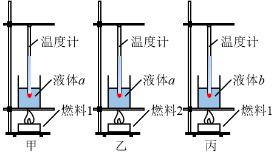

# Physics - 题目 76

**ID**: 2ff5f00fa44f455286ee51ddcaaf7071
**年级**: Grade 9
**难度**: Medium
**题型**: Experiment

## 题目
如图所示，甲、乙、丙三图中的装置完全相同。​​​​​​​‌燃料及烧杯内的液体质量也相同。比较不同物质的比热容，应选择两图的装置进行实验；比较不同燃料热值的实验中，同时点燃燃料后，需等待燃料（选填“燃烧相同时间”或“充分燃烧完毕”），然后通过观察升高的温度来比较两种燃料热值大小，实验过程是通过方式使液体内能增加的。

## 解答

1. 比较不同物质的比热容即比较吸热能力不同，应选择燃料相同、而相同质量的不同物质作为吸热物质，故选用甲丙两图的装置进行实验。
2. 比较不同燃料热值的实验中，同时点燃燃料后，需等待燃料充分燃烧，通过观察同种液体中温度计示数的上升高低来比较两种燃料热值大小。实验过程中，通过热传递的方式改变液体的内能。

## 知识点

**中文**:
  - 探究燃料的热值实验
  - 物质的比热容探究实验

**English**:
  - Experiment: Investigating Calorific Value
  - Experiment: Investigating Specific Heat Capacity

---
