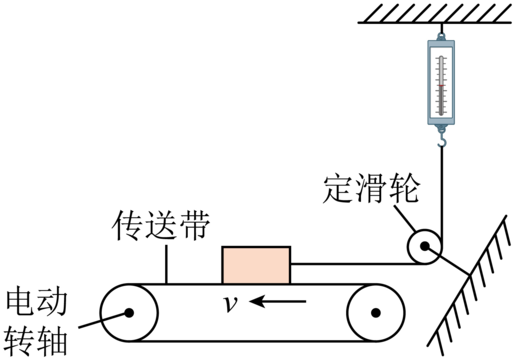
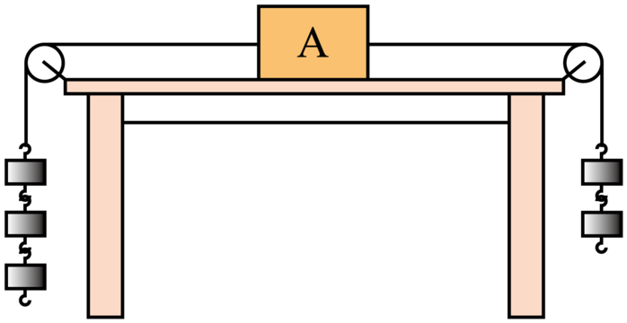

# Physics - 题目 2365

**ID**: 31e079c3b8b64bdeaa75f13675f0a130
**年级**: Grade 9
**难度**: Medium
**题型**: Experiment

## 题目
完成下列实验。​​​​​​​‌（1）小雨用如图所示的装置“探究影响滑动摩擦力大小的因素”。实验前要将弹簧测力计在（选填“水平”或“竖直”）方向上调零，某次实验中，当弹簧测力计的示数稳定后，改变传送带的速度大小，大家发现弹簧测力计的示数没有改变，说明木块所受滑动摩擦力的大小与传送带的速度大小（选填“有关”或“无关”）。（2）在做“探究二力平衡的条件”实验时，应选择较（选填“粗糙”或“光滑”）的水平桌面。如图所示实验装置，当在左、右两端同时挂不同钩码时物体A静止，此时物体A处于（选填“平衡”或“非平衡”）状态。

## 解答

1. （1）在该实验中，弹簧测力计是竖直使用，则在实验前要将弹簧测力计在竖直方向上调零。
2. 弹簧测力计的示数没有改变，说明木块所受滑动摩擦力的大小没有改变。由此可知滑动摩擦力的大小与传送带的速度大小无关。
3. （2）在“探究二力平衡的条件”实验时，为了减小摩擦力对实验的影响，应选择较光滑的水平桌面。
4. 物体处于静止或匀速直线运动状态时，都处于平衡状态，当在左、右两端同时挂不同钩码时物体A静止，所以此时物体A处于平衡状态。

## 知识点

**中文**:
  - 二力平衡条件的探究实验
  - 影响滑动摩擦力大小因素的探究实验

**English**:
  - Experiment: Conditions for Two-Force Equilibrium
  - Experiment: Factors Affecting Sliding Friction

---
