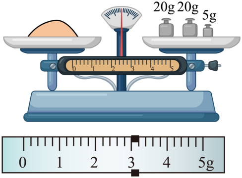

# Physics - 题目 2084

**ID**: 3231a5c0b2a34cf18ac0e74e97f201b6
**年级**: Grade 9
**难度**: Medium
**题型**: Experiment

## 题目
晓松在参观一个容积为5×10^{3}m^{3}粮仓时，想知道这粮仓能装多少重量的稻谷。​​​​​​​‌于是他取一小包稻谷作样品，进行了以下实验：（1）调节天平平衡时，发现天平的指针偏向分度标尺的右侧。此时，应将平衡螺母向调节（选填“左”或“右”），直至天平平衡。（2）取适量稻谷倒入左盘，在右盘中加减砝码，并移动称量标尺上的，使天平重新平衡。所用的砝码和游码的位置如图所示，则稻谷质量为g。将这些稻谷倒入量筒中压实，测出它的体积为40cm^{3}。（3）稻谷的密度为g/cm^{3}。（4）这样测出来的稻谷的密度（选填“偏大”、“偏小”或“没有误差”）。

## 解答

1. （1）调节天平平衡时，发现天平的指针偏向分度标尺的右侧，说明右边较重，应向左调节平衡螺母。
2. （2）取适量稻谷倒入左盘，在右盘中加减砝码，并移动称量标尺上的游码，使天平重新平衡。由图示可知，稻谷的质量 $m=20\mathrm{g}+20\mathrm{g}+5\mathrm{g}+3\mathrm{g}=48\mathrm{g}$ 。
3. （3）稻谷的体积为V=40cm^{3}，所以可求出稻谷的密度 $ρ=\frac {m}{V}=\frac {48{\rm{g}}}{4{{0}}{\rm{c}}{\rm{m}}{^{3}}}=1.2{\rm{g}}/{\rm{c}}{\rm{m}}{^{{{3}}}}$ 。
4. （4）虽将稻谷倒入量筒中压实，但稻谷间还会有空隙，因此测量稻谷的体积会偏大，由 $ρ=\frac {m}{V}$ 可知，这样测出来的稻谷密度会偏小。

## 知识点

**中文**:
  - 固体密度的测量实验

**English**:
  - Experiment: Measuring Density of Solids

---
