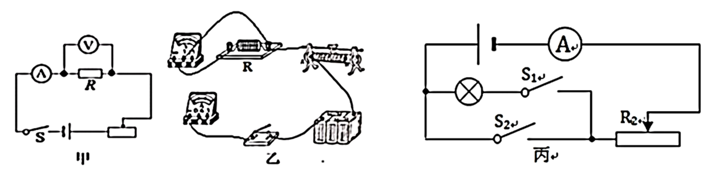

# Physics - 题目 2857

**ID**: 32c3d9030c80425395cc6cb79e5d4276
**年级**: Grade 9
**难度**: Medium
**题型**: Experiment

## 题目
利用如图甲所示的电路探究“电流与电阻的关系”。​​​​​​​‌已知电源电压U为6V且保持不变，实验用到的电阻 $R$ 的阻值分别为25Ω、20Ω、15Ω、10Ω，滑动变阻器的规格为“0～50Ω”：(1)请根据图甲，用笔画线代替导线将图乙所示的实物电路连接完整；(         )(2)为完成整个实验，应利用滑动变阻器控制 $R$ 两端的电压至少保持V不变；(3)连好电路后闭合开关，发现电流表和电压表在电路中位置颠倒，则闭合开关后，电流表示数，电压表示数；（选填“有”或“没有”）(4)完成上述实验后，小明又利用上述器材重新设计了电路（增加了一个开关）如图丙，测量另一只小灯泡的额定功率，已知这只小灯泡正常工作的电流为 $I{{}_{1}}$ 。请完成实验步骤：①只闭合开关S_{1}，移动滑动变阻器 $R{{}_{2}}$ 的滑片，；②只闭合开关S_{2}，，读出电流表的示数为 $I{{}_{2}}$ ；③则小灯泡的额定功率表达式为 $P{{}_{\mathrm{额}}}=$；(5)小张同学在进行实验时，还发现灯丝的电阻随温度的升高而增大。当通过小灯泡的电流为额定电流的一半时，小灯泡的功率为 $P{{}_{1}}$ ，当小灯泡两端电压为额定电压一半时，小灯泡的功率为 $P{{}_{2}}$ ，则 $P{{}_{1}}$$P{{}_{2}}$ （选填“大于”、“等于”、“小于”）。

## 解答

1. (1)[1]由电路图知，电流表、定值电阻、滑动变阻器串联接入电路，根据欧姆定律可得：实验电路中的最大电流为
2. $I=\frac {U}{R}=\frac {6{\rm{V}}}{10{\rm{Ω}}}=0.6{\rm{A}}$
3. 故电流表的量程应选择0～0.6A，即将定值电阻 $R$ 左接线柱与电流表0.6A接线柱相连，如下图所示。
4. 
5. (2)[2]滑动变阻器的最大值与25Ω的电阻串联时，滑动变动器分得的电压最小，根据串联电路分压的规律可得，电压表示数的最小值为
6. $\frac {U{{}_{{\rm \min }}}}{U}=\frac {R{{}_{{\rm \max }}}}{R{{}_{总}}}=\frac {R{{}_{{\rm \max }}}}{R{{}_{{\rm \max }}}+R{{}_{滑{\rm \max }}}}=\frac {25{\rm{Ω}}}{25{\rm{Ω}}+50{\rm{Ω}}}=\frac {1}{3}$
7. 最小值为
8. $U{{}_{{\rm \min }}}=\frac {1}{3}U=\frac {1}{3}\times 6{\rm{V}}=2{\rm{V}}$
9. (3)[3][4]连好电路后闭合开关，发现电流表和电压表在电路中位置颠倒，则此时电流表与电阻R并联，电阻被短路；电压表串联接入电路，相当于电路断路，电压表测电源电压，故电压表有示数，电流表没有示数。
10. (4)①[5]只闭合开关S_{1}，移动滑动变阻器 $R{{}_{2}}$ 的滑片，直至电流表A读数为 $I{{}_{1}}$ 。
11. ②[6]只闭合开关S_{2}，保持滑片P不动，读出电流表的示数为 $I{{}_{2}}$ 。
12. ③[7]变阻器接入电路的电阻为
13. $R{{}_{2}}{^{\prime }}=\frac {U}{I{{}_{2}}}$
14. 只闭合开关S_{1}时，变阻器两端的电压为
15. $U{{}_{2}}=I{{}_{1}}R{{}_{2}}{^{\prime }}=\frac {I{{}_{1}}U}{I{{}_{2}}}$
16. 灯两端的电压为
17. $U{{}_{{\rm{L}}}}=U-U{{}_{2}}=U-\frac {I{{}_{1}}U}{I{{}_{2}}}=\frac {\left ({I{{}_{2}}-I{{}_{1}}}\right )U}{I{{}_{2}}}$
18. 则灯的额定功率为
19. $P=U{{}_{{\rm{L}}}}I{{}_{1}}=\frac {\left ({I{{}_{2}}-I{{}_{1}}}\right )U}{I{{}_{2}}}I{{}_{1}}=\frac {I{{}_{1}}\left ({I{{}_{2}}-I{{}_{1}}}\right )}{I{{}_{2}}}\times 6{\rm{V}}$
20. (5)[8]由于灯泡的电阻随温度的升高而增大，由 $P=I{^{2}}R$ 可知，灯泡实际电流等于额定电流一半时，实际功率
21. $P{{}_{1}}<\frac {1}{4}P{{}_{额}}$
22. 由 $P=\frac {U{^{2}}}{R}$ 可知，灯泡的实际电压等于额定电压一半时，它的实际功率
23. $P{{}_{2}}>\frac {1}{4}P{{}_{额}}$
24. 故
25. $P{{}_{1}}<P{{}_{2}}$

## 知识点

**中文**:
  - 其他方法测量小灯泡的电功率
  - 电流与电阻关系的探究实验

**English**:
  - Other Methods for Measuring Bulb Power
  - Experiment: Relationship between Current and Resistance

---
