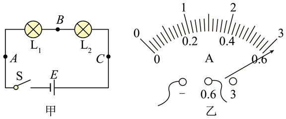

# Physics - 题目 11

**ID**: 349c6a77944b4f2fbed09f01f2c82ea6
**年级**: Grade 9
**难度**: Medium
**题型**: Experiment

## 题目
在“探究串联电路中电流的规律”实验中：（1）实验中除了电源，开关，导线，两只灯泡，还需要：；（2）在连接电路时开关要；（3）电流表要联在电路中，并用法选择合适的量程；（4）实验时电流表指针如图所示，其原因是：；（5）小明设计记录数据表格如下，指出表格设计两处不足之处：①；②；A点电流I_{A}B点电流I_{B}C点电流I_{C}第一次测量0.540.540.54（6）分析数据，得出规律：。​​​​​​​‌

## 解答

1. （1）“探究串联电路中电流的规律”实验中，需要用电流表测量电路中的电流，所以,还需要用到电流表。
2. （2）实验中，为了保护电路，连接电路时，开关要断开。
3. （3）电流表测量电流时，要与用电器串联在电路中，在不能估计电流时，要用最大量程进行“试触”， 根据指针偏转情况选择合适的量程。
4. （4）由图知道，指针摆角太大，超出了满偏的刻度，而选取的量程却是0到0.6A，所以说明此时是电流表的量程太小。
5. （5）根据表格中的数据知道，表格设计两处不足之处是：表中记录的电流均没有在表头中写出单位；没有设计多次测量的表格。
6. （6）根据数据知道，在串联电路中，测量的A、B、C三处的电流是相同的，故得出规律是在串联电路中，各处的电流是相同的。

## 知识点

**中文**:
  - 探究串、并联电路的电流规律实验

**English**:
  - Experiment: Current Laws in Series/Parallel

---
