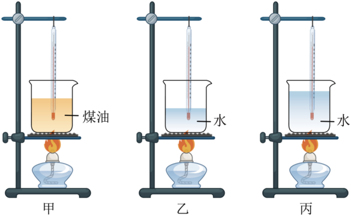

# Physics - 题目 85

**ID**: 3748fcb8a1ba4f8ebc936b6cb2c1536a
**年级**: Grade 9
**难度**: Medium
**题型**: Experiment

## 题目
为了比较水和煤油的吸热能力，某实验小组用规格完全相同的实验器材，对初温相同的100g煤油、100g水、200g水进行加热，如图所示。​​​​​​​‌（1）若要探究不同物质的吸热能力，应选择两图进行对比实验；（2）在此实验中一般用控制相同的方法，来保证水和煤油吸收的热量相同，通过比较它们（均选填字母）来比较水和煤油吸热能力的不同；

## 解答

1. （1）若要探究不同物质的吸热能力，根据控制变量法，应保持液体的质量相同，种类不同，而水的密度比煤油大，质量相同时，则体积应该比煤油小，故应选择甲、乙装置进行实验。
2. （2）实验中采用相同的加热器进行加热，相同时间产生的热量相同，可以控制加热时间来间接反映吸热的多少，运用了转换法。等质量的不同物质，吸收相同的热量，上升的温度不同，上升的温度越大，表明吸热能力越弱，故通过比较它们温度的变化来比较水和煤油吸热能力的不同。
3. （3）根据图像可知，等质量的水和煤油，加热相同时间即吸收相同的热量，煤油上升的温度更大，故若使初温相同、质量相等的水和煤油吸收相等的热量，两杯液体所能达到的温度不同。

## 知识点

**中文**:
  - 物质的比热容探究实验

**English**:
  - Experiment: Investigating Specific Heat Capacity

---
