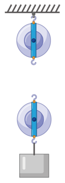

# Physics - 题目 2474

**ID**: 3cf0ea15bbae445b9dfca4605c643862
**年级**: Grade 9
**难度**: Medium
**题型**: Experiment

## 题目
小金和小明在探究“影响滑轮组机械效率的因素”时，提出了如下猜想：猜想一：滑轮组机械效率与被提升物体所受的重力有关；猜想二：滑轮组机械效率与动滑轮所受的重力有关。​​​​​​​‌为了验证猜想，准备的器材如下：两个相同的滑轮、一根细绳、钩码若干、刻度尺和弹簧测力计。小金把两个滑轮分别作为定滑轮和动滑轮组装成滑轮组，用该滑轮组提升不同数量的钩码进行了三次实验，数据如表所示：请你解答如下问题：实验次数钩码所受的重力G/N提升高度h/m拉力F/N绳端移动的距离s/m机械效率η12.00.11.00.366.7%24.00.11.80.374.1%36.00.12.50.3（1）表中第3次实验时滑轮组的机械效率为。根据表中数据在图中画出该滑轮组的绕线方式；（2）分析表中数据可知：用同一滑轮组提升不同的物体，物体越重，滑轮组的机械效率（选填“越高”、“越低”或“不变”）；（3）利用提供的器材，（选填“能”或“不能”）验证猜想二；（4）小明在实验中发现：一边拉动弹簧测力计一边读数，由于测力计示数不稳定，非常不方便。为了方便读数，他提出可以让弹簧测力计保持静止时读数，他的这种想法显然不合理，因为他没有考虑到对滑轮组机械效率的影响。如果让弹簧测力计保持静止时读数，则所测出的滑轮组机械效率比真实值（选填“偏大”、“偏小”或“不变”）。

## 解答

1. （1）[1]由表中数据可知，第3次实验时滑轮组的机械效率为
2. $η=\frac {W{{}_{有}}}{W{{}_{总}}}\times 100\%=\frac {Gh}{Fs}=\frac {6.0{\rm{N}}\times 0.1{\rm{m}}}{{\rm{2}}{\rm{.}}{\rm{5}}{\rm{N}}\times 0.3{\rm{m}}}={\rm{8}}{\rm{0}}{\rm{\%}}$
3. [2]由提升高度和绳端移动的距离可得，承担物重绳子的股数为
4. $n=\frac {s}{h}=\frac {0.3{\rm{m}}}{0.1{\rm{m}}}=3$
5. 故绳子从动滑轮开始绕线，如图所示：
6. 
7. （2）[3]由表中数据可知，从第1次实验到第3次实验，钩码所受的重力逐渐增大，滑轮组的机械效率逐渐增大。故用同一滑轮组提升不同的物体，物体越重，滑轮组的机械效率越高。
8. （3）[4]为探究滑轮组机械效率与动滑轮所受的重力有关，应该控制提升物体所受重力不变，改变动滑轮的重力，因此还需要的实验器材是自重不同的滑轮，而准备的是两个相同的滑轮，故不能验证猜想二。
9. （4）[5][6]让弹簧测力计保持静止时读数时，绳子与滑轮之间的摩擦力与拉动时的摩擦力不同，会影响克服摩擦所做功的大小，因此他没有考虑摩擦力对滑轮组机械效率的影响。此时不需要克服摩擦力做功，故做的额外功减少，有用功不变，总功减少，由 $η=\frac {W{{}_{有}}}{W{{}_{总}}}\times 100\%$ 可知，所测出的滑轮组机械效率比真实值偏大。

## 知识点

**中文**:
  - 滑轮（组）的机械效率的测量实验

**English**:
  - Experiment: Measuring Mechanical Efficiency of Pulleys

---
