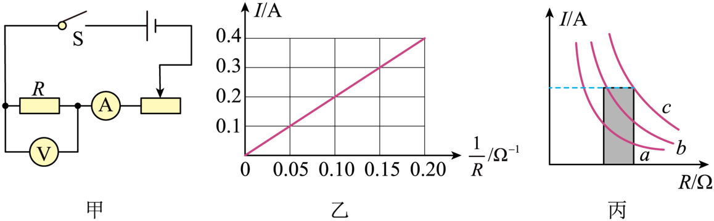

# Physics - 题目 1337

**ID**: 41650a127dc9410ab4baf1b341d1f369
**年级**: Grade 9
**难度**: Medium
**题型**: Experiment

## 题目
如图所示，电源电压为3V保持不变，滑动变阻器规格“20Ω　1A”，定值电阻的阻值5Ω、15Ω、20Ω，利用上述的实验器材探究“电流与电阻的关系”。​​​​​​​‌（1）先将5Ω的定值电阻接入电路中，调节滑动变阻器，当电压表示数为2V时，记录电流表的示数；（2）不改变滑动变阻器滑片的位置，将5Ω的电阻换成10Ω的电阻，闭合开关，向（选填“左”或“右”）移动滑动变阻器滑片，移动过程中眼睛注视（选填“电压表”或“电流表”）的示数；（3）换接不同的定值电阻，重复上述的实验步骤，绘出电流I与电阻倒数1/R变化的图象如图乙，由图乙可知：电压一定时，电流与电阻成比；（4）对“探究电流与电阻关系”的实验过程进一步分析、论证，绘制了实验过程中“电流与定值电阻、电流与滑动变阻器，电流与总电阻”之间的图象，如图丙，其中反映电流与定值电阻关系的是（选填“a”“b”或“c”），图中阴影部分面积表示的物理含义是。

## 解答

1. （2）根据控制变量法可知，探究“电流与电阻的关系”应控制电阻两端电压不变，不改变滑动变阻器滑片的位置，将5Ω的电阻换成10Ω的电阻，闭合开关，根据串联电路分压原理可知，滑动变阻器接入电路的电阻需变大，所以需向右移动滑片，移动过程中眼睛注视电压表的示数，直到电压表的示数为2V，然后读出电流表的示数。
2. （3）换接不同的定值电阻，重复上述的实验步骤，绘出电流I与电阻倒数 $\frac {1}{R}$ 变化的图象如图乙，图乙是一条过原点的直线，说明I与 $\frac {1}{R}$ 成正比，故可得：电压一定时，电流与电阻成反比。
3. （4）实验中定值电阻两端的电压为2V，滑动变阻器两端的电压为1V，由串联电路电压规律知，滑动变阻器接入电路的阻值小于定值电阻。根据欧姆定律可知，电流与电阻的乘积为电压，三线中 $IR$ 乘积最大的c线为电流与总电阻的图象，三线中 $IR$ 乘积最小的a线为电流与滑动变阻器的图象，三线中 $IR$ 乘积中间的b线为电流与定值电阻的图象。
4. 由图可知，阴影部分的面积等于c线 $IR$ 的乘积与b线 $IR$ 的乘积之差，根据串联电路电压规律可知，阴影部分的面积表示滑动变阻器两端的电压。

## 知识点

**中文**:
  - 电流与电阻关系的探究实验

**English**:
  - Experiment: Relationship between Current and Resistance

---
