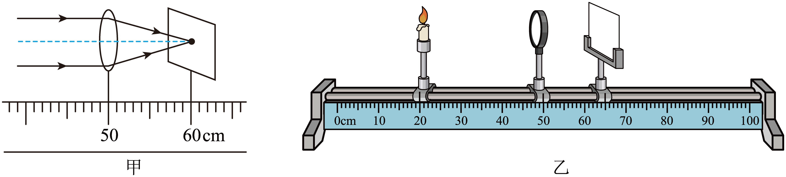

# Physics - 题目 2847

**ID**: 4311f96749d44c60bf0a399e3d975788
**年级**: Grade 9
**难度**: Medium
**题型**: Experiment

## 题目
乐乐同学在探究“凸透镜成像规律”的实验。​​​​​​​‌①如图甲所示，乐乐将一束平行光正对凸透镜，移动光屏，直到光屏上形成一个最小最亮的光斑，该凸透镜的焦距为cm；②在某次实验中，乐乐将蜡烛、凸透镜、光屏放在光具座上如图乙所示的位置，光屏上呈现清晰的像，此像是倒立、（选填“放大”“等大”或“缩小”）的实像；若要再模拟近视眼成因，乐乐仅需将光屏向移动少许（选填“左”或“右”）。

## 解答

1. ①平行光正对凸透镜照射，光屏上出现一个最小最亮的光斑，最小最亮的光斑为焦点，由图甲得，凸透镜的焦距 $f=60.0{\rm{c}}{\rm{m}}-50.0{\rm{c}}{\rm{m}}=10.0{\rm{c}}{\rm{m}}$ 。
2. ②由图乙得，此时物距 $u=50.0{\rm{c}}{\rm{m}}-20.0{\rm{c}}{\rm{m}}=30.0{\rm{c}}{\rm{m}}$ ，物距大于二倍焦距，像距 $v=65.0{\rm{c}}{\rm{m}}-50.0{\rm{c}}{\rm{m}}=15.0{\rm{c}}{\rm{m}}$ ，像距在一倍焦距和二倍焦距之间，根据凸透镜成像规律，此时凸透镜成的是倒立、缩小的实像。近视眼的成因是晶状体太厚，导致像成在视网膜前方，光屏相当于视网膜，则仅需将光屏向右移动少许。

## 知识点

**中文**:
  - 凸透镜成像规律的探究实验

**English**:
  - Experiment: Imaging Rules of Convex Lenses

---
