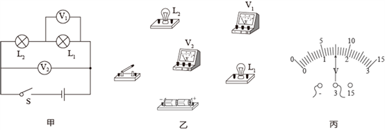

# Physics - 题目 2528

**ID**: 475d13f40765408898b6fc19aeabf1b3
**年级**: Grade 9
**难度**: Medium
**题型**: Experiment

## 题目
小亮同学在“探究串联电路中电压的规律”的实验中，设计了如图甲所示的电路图【小题】(1)根据电路图，用笔画线代替导线将如图乙所示的实物连接完整。​​​​​​​‌【小题】(2)连接电路的过程中，开关必须（选填“断开”或“闭合”）。【小题】(3)请你为实验需要测量和计算的物理量，设计一个实验数据记录表格。【小题】(4)某次实验时，电压表V_{1}的示数如图丙所示，其读数为V。【小题】(5)实验时，小亮同学应选择规格（选填“相同”或“不相同”）的灯L_{1}、L_{2}。

## 解答

1. (1)两灯串联，V_{2}测电源电压，V_{1}测L_{1}电压。
2. 
3. (2)为保护电路，连接电路的过程中，开关必须断开。
4. (3)如表所示。
5. 次数
6. 灯L_{1}两端的电压U_{1}／V
7. 灯L_{2}两端的电压U_{2}／V
8. 灯L_{1}、L_{2}两端的总电压U／V
9. 1
10. 2
11. 3
12. (4)电压表用小量程，分度值0.1V，读数为1.5V。
13. (5)在探究“串联电路的电压特点”时，为得出普遍性的规律，应选择规格不相同的灯泡。

## 知识点

**中文**:
  - 探究串、并联电路中的电压规律实验

**English**:
  - Experiment: Voltage Laws in Series/Parallel

---
