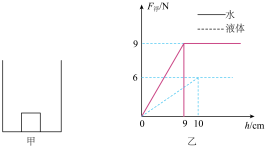

# Physics - 题目 731

**ID**: 48be60d45abf4fb8983e24584c6c4d2d
**年级**: Grade 9
**难度**: Medium
**题型**: Experiment

## 题目
将一正方体物块放入圆柱形容器底部，如图甲所示。​​​​​​​‌逐渐向容器内倒入水（水未溢出），测量容器内水的深度h，分别计算出该物块对应受到的浮力 $F{{}_{浮}}$ ，并绘制了如图乙（实线）所示的图像；又更换一种液体重复上述实验，绘制了如图乙（虚线）所示的图像（ $g=10{\rm{N}}{\rm{/}}{\rm{k}}{\rm{g}}$ ）。【小题】（1）在水中， $h=10{\rm{c}}{\rm{m}}$ 时，物块处于状态（选填“漂浮”、“悬浮”或“沉底”）。请在甲图中画出没有液体时物块受到杯底的支持力的示意图。【小题】（2）当水对物块的浮力为 $6{\rm{N}}$ 时，水的深度为${\rm{c}}{\rm{m}}$ ，物块的密度为${\rm{k}}{\rm{g}}{\rm{/}}{\rm{m}}{^{{\rm{3}}}}$ 。【小题】（3）在另外一种液体中时， $h=11{\rm{c}}{\rm{m}}$ 时，物块处于状态（选填“漂浮”、“悬浮”、“沉底”）。

## 解答

1. （1）水的深度9cm以后物体受到的浮力9N不再发生变化，加另一种液体10cm后浮力也不变，说明物体边长超过10cm，所以在水中加水10cm肯定没有完全浸没，而是漂浮。
2. 漂浮时浮力等于重力，所以重力为9N，没有液体时物块对杯底压力等于重力9N，所以支持力也是9N，方向向上，如图。
3. 
4. （2）由图可知，浮力与水的深度为正比例函数，且深度9cm浮力是9N，由正比例函数可知，浮力为6N时，水深度为6cm；在水中刚刚漂浮时，物体底部水压强为
5. $p=ρ{{}_{水}}gh=10{^{3}}{\rm{k}}{\rm{g}}{\rm{/}}{\rm{m}}{^{3}}\times 10{\rm{N}}{\rm{/}}{\rm{k}}{\rm{g}}\times {\rm{0}}{\rm{.}}{\rm{0}}{\rm{9}}{\rm{m}}{\rm{=}}{\rm{9}}{\rm{0}}{\rm{0}}{\rm{P}}{\rm{a}}$
6. 由浮力产生原因可知，物体底面积为
7. $S=\frac {F{{}_{浮}}}{p}=\frac {9{\rm{N}}}{900{\rm{P}}{\rm{a}}}=0.01{\rm{m}}{^{2}}$
8. 因为是正方体，所以边长0.1m，体积0.001m^{3}，所以密度为
9. $ρ=\frac {m}{V}=\frac {G}{gV}=\frac {F{{}_{浮}}}{gV}=\frac {9{\rm{N}}}{10{\rm{N}}{\rm{/}}{\rm{k}}{\rm{g}}\times 0.001{\rm{m}}{^{3}}}=0.9\times 10{^{3}}{\rm{k}}{\rm{g}}{\rm{/}}{\rm{m}}{^{3}}$
10. （3）由图象可知，当h=10cm以后物体在液体中受到的浮力F_{浮}′=6N不变，因F_{浮}′＜G，所以，物体处于沉底状态。

## 知识点

**中文**:
  - 实验探究物体的浮沉条件

**English**:
  - Experiment: Investigating Floating/Sinking Conditions

---
