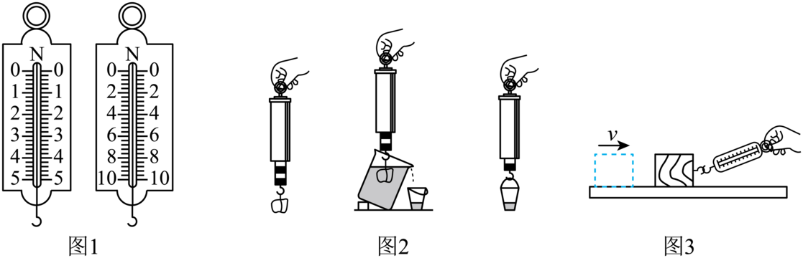

# Physics - 题目 256

**ID**: 4df508c528b14c8ea9ef7d1abc7a42fd
**年级**: Grade 9
**难度**: Medium
**题型**: Experiment

## 题目
亲爱的同学们，请你用学过的知识回答下列问题（1）如图1所示的两个弹簧测力计，现要测量一个重约2.​​​​​​​‌6N的物体应该选用（选填“A”或“B”）更好（2）如图2所示，小明在做“探究阿基米德原理实验”时，其操作步骤如下

## 解答

1. （1）被测物体重力为2.6N，在两弹簧测力计的量程内，因此选择A弹簧测力计，精确度更高，测量更准确；
2. （2）在此实验中，要求比较物体受到的浮力和排开液体的重力，实验步骤中只测量了物体受到的浮力，排开液体的重力没有单独测出，因此需要额外测出小桶的重力，用以计算排开液体的重力。
3. 本实验得出的结论是阿基米德原理，表达式为 $F{{}_{浮}}=G{{}_{排}}$
4. （3）本实验中，需要使弹簧测力计示数，即拉力大小与摩擦力大小相等，因此需要沿水平方向拉动木块，做匀速直线运动，此时木块受到的拉力和摩擦力就是一对平衡力。
5. 滑动摩擦力大小的影响因素有压力大小和接触面的粗糙程度，本题中接触面的粗糙程度没有变，放上砝码后压力增大，因此滑动摩擦力变大。

## 知识点

**中文**:
  - 实验探究阿基米德原理
  - 影响滑动摩擦力大小因素的探究实验

**English**:
  - Experiment: Investigating Archimedes' Principle
  - Experiment: Factors Affecting Sliding Friction

---
