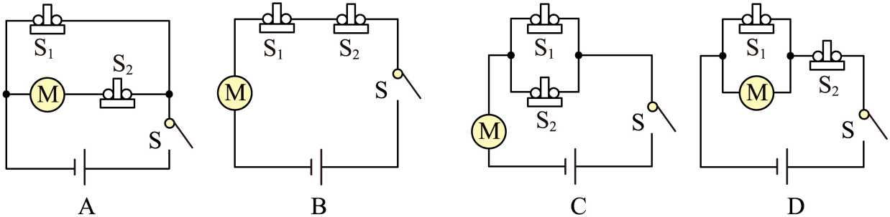

# Physics - 题目 231

**ID**: 4df904d16e684dde85de939824fee512
**年级**: Grade 9
**难度**: Medium
**题型**: Experiment

## 题目
电动自行车因为具有轻便、快捷和环保等优点备受大家喜爱，然而电动车带来的安全问题也很严重。​​​​​​​‌2023年4月15日起，《电动自行车安全技术规范》开始实施。小明和学习小组同学展开了：“安全的电动车”的学习活动。下面是该小组同学交流的实践过程，请帮助完成下列内容：（1）了解“刹车系统”。电动自行车刹车时，电动机必须断电。因此，人们在电动自行车左右两刹车手柄中各安装了一只开关S_{1}和S_{2}，S是用钥匙控制的电源开关。在行驶中用任意一只手柄刹车时，开关S_{1}或S_{2}断开，电动机立即断电。下列电路中符合这一要求的是；（2）了解“蓄电池”。电池说明书上的部分内容：①额定电压：36V；②“电池容量10A·h”；③电能转化为机械能的效率为75%。电动车工作过程中最多能输出的机械能为J。若这么多的机械能由效率为30%的汽油机提供，则需要燃烧汽油kg（已知汽油的热值为4.5×10^{6}J/kg）。（3）优化充电系统。电动自行车电池不能长时间充电，为了电动自行车的充电安全，小组设计了如图甲所示的定时充电器。用定时器控制充电时间，当定时器中有电流通过时，充电就会被断开。针对该充电器的设计方案，下面说法正确的是；

## 解答

1. （1）由题知，任一只手柄刹车时，该手柄上的开关立即断开，电动机停止工作，说明两开关相互影响、不能独立工作，所以两个开关、电动机以及S应串联接在电路中，故B符合题意，ACD不符合题意。
2. （2）“蓄电池”储存的电能 $E=UIt=36{\rm{V}}\times 10\times 3600{\rm{A}}\cdot {\rm{s}}=1.296\times 10{^{6}}{\rm{J}}$ ，最多能输出的机械能 $E{{}_{机}}=Eη=1.296\times 10{^{6}}{\rm{J}}\times 75\%=9.72\times 10{^{5}}{\rm{J}}$ ，汽油完全燃烧放出的热量 $Q{{}_{放}}=\frac {E{{}_{机}}}{η^{′}}=\frac {9.72\times 10{^{5}}{\rm{J}}}{30{\rm{\%}}}=3.24\times 10{^{6}}{\rm{J}}$ ，需要燃烧汽油的质量 $m=\frac {Q{{}_{放}}}{q}=\frac {3.24\times 10{^{6}}{\rm{J}}}{4.5\times 10{^{6}}{\rm{J}}/{\rm{k}}{\rm{g}}}=0.72{\rm{k}}{\rm{g}}$ 。
3. （3）A．由电路图可知，定时器与充电器并联，故A错误；
4. B．充电时定时器中不能有电流通过，所以定时器在电路中相当断路，故B错误；
5. C．当定时器中有电流通过时，充电就会被断开，将充电器短路，使充电器不能工作，故C正确；
6. D．如果在b处安装一个开关S，断开此开关，由于定时器与充电器并联，则充电器仍然连入电路，故充电器不会停止充电，故D错误。
7. （4）插座按照左零右火接线，故右边接在c处，因为开关只控制灯泡，故左边接在a处，故插座应安装在ac之间。蓄电池一次充满电后的能量一定，所做总功一定，负重越大，所受的阻力越大，由于 $W=Fs$ ，车子运动时受到的阻力会影响电动车充满电后的最大行驶路程。

## 知识点

**中文**:
  - 串、并联电路的设计
  - 功的计算和估算
  - 热值及相关计算
  - 电功与电能的计算

**English**:
  - Designing Series and Parallel Circuits
  - Calculation and Estimation of Work
  - Calorific Value and Calculations
  - Calculation of Electric Work and Energy

---
