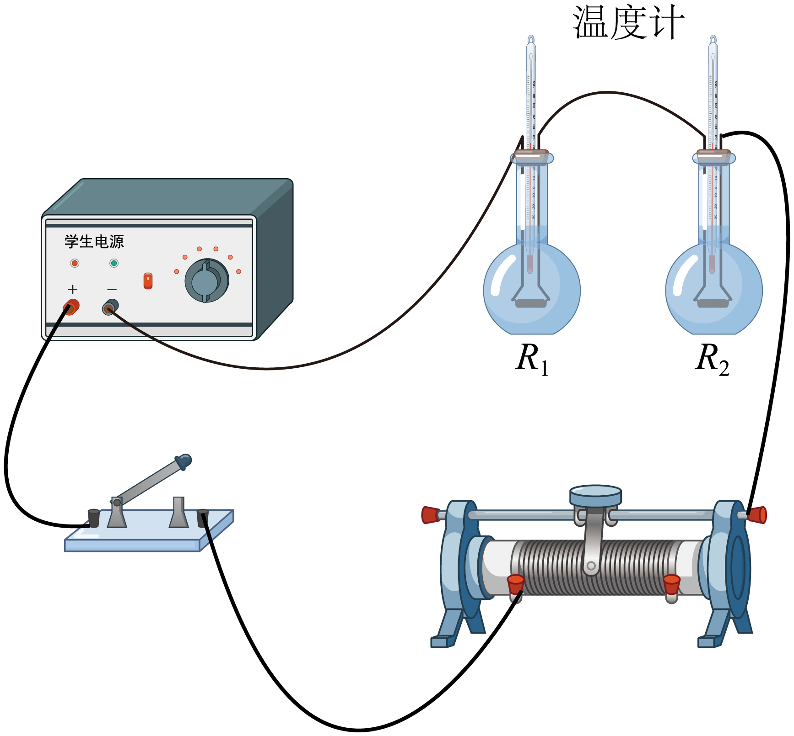

# Physics - 题目 2919

**ID**: 4f1444073b2c401ea260d8f70fb438b8
**年级**: Grade 9
**难度**: Medium
**题型**: Experiment

## 题目
物理小组同学利用如图所示的装置探究“电流产生的热量与哪些因素有关”，从实验室找来两个阻值大小不等的电热丝R_{1}和R_{2}，将它们分别装入图所示的甲、乙两个完全相同的烧瓶中，并在烧瓶中加入质量、初温均相同的煤油，再分别插入相同的温度计。​​​​​​​‌请按要求完成下列问题：（1）实验过程中观察温度计示数的变化来反映电流产生热量的多少，这是利用了转换法。下面实例中不是应用“转换法”的是；

## 解答

1. （1）[1]A．用磁感线方便形象地描述磁场的分布采用的是模型法，故A符合题意；
2. B．在探究动能大小影响因素的实验中，利用水平面上木块被推动的距离反映物体动能大小采用的是转换法，故B不符合题意；
3. C．在研究磁体磁性强弱时，利用磁体吸引铁屑的多少反映磁体磁性的强弱采用的是转换法，故C不符合题意；
4. D．在探究液体内部压强时，利用微小压强计U型管液面高度差反映液体压强的大小采用的是转换法，故D不符合题意。
5. 故选A。
6. （2）[2]根据 $Q=cm\left ({t{{}_{1}}-t{{}_{2}}}\right )$ 可知，在物质种类相同，质量和初温相同的情况下，液体吸收热量的多少可以通过液体末温来反应，末温越高，液体吸收的热量也多，即在相同时间内，电流通过电热丝产生热量的多少越多。

## 知识点

**中文**:
  - 影响电流热效应因素的探究实验

**English**:
  - Experiment: Factors Affecting Heating Effect

---
