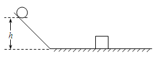

# Physics - 题目 2557

**ID**: 51e3f7a2ccb3450e9f5691451bee81ce
**年级**: Grade 9
**难度**: Medium
**题型**: Experiment

## 题目
某班同学在探究“动能的大小与什么因素有关”时，同学们提出了如下猜想：猜想一：动能的大小可能与物体的密度有关；猜想二：动能的大小可能与物体的运动速度有关；猜想三：动能的大小可能与物体的质量有关；为了验证同学们的猜想，老师提供如下器材：刻度尺、四个金属球（100g 的铁球、100g 的铝球、60g 的铁球、50g 的铝球）、小木块和长木板；同学们组装了图所示的实验装置，让小球从斜面上由静止滚下，碰上水平面上的小木块后，将木块撞出一段距离。​​​​​​​‌在同样的平面上，木块被撞得越远，说明球的动能越大；请你帮同学们完成下列任务：(1)为了探究 “猜想一”，应该选用和；从斜面的（填相同或不同）高度由静止释放，去撞击木块，然后比较；(2)设计出探究“猜想三”的记录数据表格。()

## 解答

1. (1)[1][2]若探究动能的大小可能与物体的密度有关，由控制变量法知道，应该选取密度不同、物体的质量相同的小球，所以，应该选取金属球100g 的铁球、100g 的铝球，
2. [3][4]分别让两小球从斜面上同一高度从静止开始滚下，这样可以控制小球到达水平面的速度相同，通过比较木块被撞后移动的距离，判断球动能的大小。
3. (2)[5]探究动能的大小可能与物体的质量是否有关，应该选取相同密度的小球，分别让其从斜面上同一高度从静止开始滚下，通过比较木块被撞后移动的距离，判断球动能的大小。
4. 记录数据表格如下：
5. 次数
6. 小球质量
7. 小球释放的高度h/cm
8. 小球密度
9. 木块被撞出的距离s/cm
10. 结论
11. 1
12. 不同
13. 相同
14. 相同
15. 2
16. 不同
17. 相同
18. 相同
19. 3
20. 不同
21. 相同
22. 相同

## 知识点

**中文**:
  - 探究影响物体动能大小因素的实验

**English**:
  - Experiment: Factors Affecting Kinetic Energy

---
