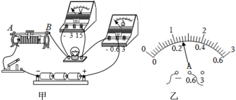

# Physics - 题目 2851

**ID**: 55e2760a751c4f9bade516bd9d0683f4
**年级**: Grade 9
**难度**: Medium
**题型**: Experiment

## 题目
实验小组用伏安法测量小灯泡的电阻，连接了如图甲所示的电路，小灯泡的额定电压为2.5V，电源由三节干电池串联而成。​​​​​​​‌（1）对于如图甲所连接的电路，有同学认为存在不妥之处，请你指出来：；（2）重新连接电路之后，闭合开关前，为了电路安全应移动滑动变阻器的滑片至（选填“A”或“B”）端；（3）调节滑片的位置，小灯泡正常发光时，电流表的示数如图乙所示，此时小灯泡的电阻是Ω（保留1位小数）；（4）实验时，由于操作失误，在未断开开关的情况下，直接将亮着的小灯泡从灯座上拧下来，拧下灯泡后电压表的示数会（选填“变大“变小”或“不变”）。

## 解答

1. （1）如图甲，实验用伏安法测量小灯泡的电阻时，小灯泡的额定电压为2.5V，电压表应接小量程，图甲存在的不妥之处是：电压表量程选错。
2. （2）闭合开关前，为了电路安全，滑动变阻器应滑到最大值，即应移动滑动变阻器的滑片至B端。
3. （3）电流表的示数如图乙，电流表选小量程，分度值是0.02A，读数为0.24A，此时小灯泡的电阻。
4. （4）在未断开开关的情况下，直接将亮着的小灯泡从灯座上拧下来，小灯泡断路，滑动变阻器串联在电路中，因电压表电阻很大，电压表的示数接近电源电压，因此拧下灯泡后电压表的示数会变大。

## 知识点

**中文**:
  - 伏安法测电阻的探究实验

**English**:
  - Experiment: Measuring Resistance (Voltammetry)

---
