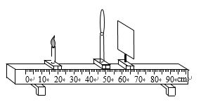

# Physics - 题目 2169

**ID**: 597907f190a54dc1886c4b3d3289c27b
**年级**: Grade 9
**难度**: Medium
**题型**: Experiment

## 题目
某小组做探究凸透镜成像规律实验，凸透镜焦距为10厘米，实验装置如图所示，实验前必须调整这个器材的高度。​​​​​​​‌调整后将蜡烛向右移动15厘米，要在光屏上得到清晰的像，应将光屏向（选填“左”或“右”）移动。移动后小明观察到光屏上呈现出的烛焰像与（选填 “照相机”、 “投影仪”或“放大镜”）的成像特点一样。在“探究平面镜成像的特点”实验中，用作为平面镜。

## 解答

1. [1]图中凸透镜高度明显偏高，应调节凸透镜高度，使凸透镜光心、蜡烛焰心、光屏中心在同一水平线上。
2. [2]图中的蜡烛向右移动15cm后距离凸透镜15cm，则u=15cm， $f<u<2f$ ，那么 $v>2f=20cm$ ，所以调整后将蜡烛向右移动15厘米，要在光屏上得到清晰的像，应将光屏向右移动。
3. [3]当物体在一倍、二倍焦距之间时，成像在二倍焦距之外，成倒立、放大的实像，投影仪就是应用了此成像特点。
4. [4]为了方便观察像与物体的大小关系，在“探究平面镜成像的特点”实验中，用玻璃板代替平面镜。

## 知识点

**中文**:
  - 凸透镜成像规律的探究实验

**English**:
  - Experiment: Imaging Rules of Convex Lenses

---
