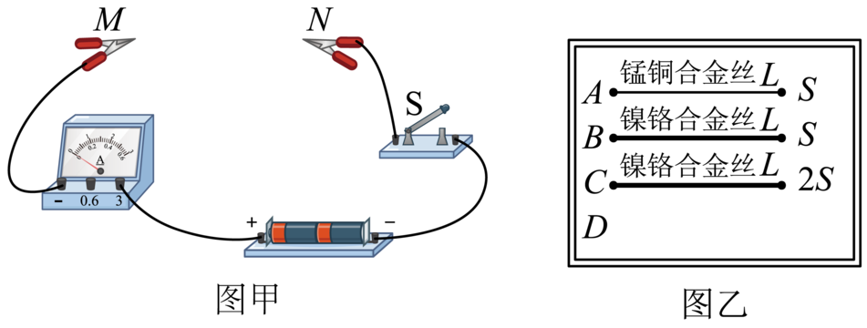

# Physics - 题目 2128

**ID**: 59c2a11199f34d339f8fd4218e7c7c48
**年级**: Grade 9
**难度**: Medium
**题型**: Experiment

## 题目
九年四班的同学们在“探究影响导体电阻大小的因素”的实验中，提出了如下猜想：猜想一：导体电阻的大小跟导体的材料有关猜想二：导体电阻的大小跟导体的横截面积有关猜想三：导体电阻的大小跟导体长度有关为了验证猜想是否正确，老师提供的器材如图所示，其中图甲所示的实验板上固定了A、B、C三根金属丝，D金属丝已损坏；A为锰铜合金丝，B、C均为镍铬合金丝，S表示合金丝的横截面积，L表示合金丝的长度。​​​​​​​‌实验时，将电阻丝分别接入电路中的M、N之间，记录每次实验电流表示数，分析数据得出结论。请你完成下列内容：（1）为了验证猜想一，应选用金属丝和进行实验。（填写字母）（2）为了验证猜想二，沈仔细同学将AC金属丝分别接入电路时，电流表的示数分别为I_{a}、I_{c}，且I_{a}>I_{c}，他得出“导体的电阻跟导体的横截面积有关”的结论，你认为他的操作（选填“正确”或“不正确”），原因是。（3）若想通过实验板中CD金属丝来验证第三个猜想，选用的金属丝D的材料为，与C金属丝的长度（选填“相同”或“不同”），横截面积为（填写字母）。

## 解答

1. （1）研究电阻与导体材料的关系，要保持导线的长度和横截面积相同而材料不同，所以选AB两根导线进行该实验。
2. （2）研究导体电阻的大小跟导体的横截面积有关，要控制材料和长度一定，而AC电阻丝的材料和横截面积都不同，所以沈仔细得出结论是不正确的。
3. （3）研究电阻和导体长度的关系，要控制材料和横截面积一定，所以选用的金属丝D的材料为镍铬合金丝，与C金属丝的长度不同，横截面积与C的横截面积相同，横截面积为2S。

## 知识点

**中文**:
  - 影响导体电阻大小因素的探究实验

**English**:
  - Experiment: Factors Affecting Resistance

---
