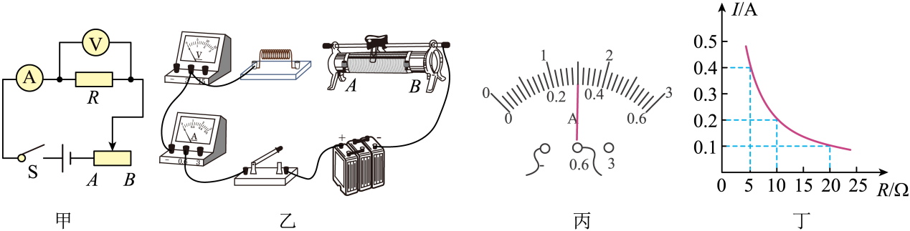

# Physics - 题目 2482

**ID**: 5b5e2e1e01dc42cca5ba3a4e5487d972
**年级**: Grade 9
**难度**: Medium
**题型**: Experiment

## 题目
小聪在探究“通过导体的电流与导体电阻的关系”时，所用电路图如图甲所示。​​​​​​​‌（1）用笔画线代替导线，将图乙中的电路按甲图连接完整（要求导线不交叉）。（2）实验前，滑动变阻器的滑片应位于（填“A”或“B”）端，这样做的目的是（3）电路连接正确后，闭合开关，发现两电表中只有一个有示数，则出现的故障可能是（选填字母）。

## 解答

1. （1）根据甲图的电路图可知，图乙中的电路如下图所示
2. 
3. （2）为了保护电路，连接电路时，开关应断开，闭合开关前，滑动变阻器的滑片应位于阻值最大处，即B端。
4. （3）根据题意可知，电路连接正确后，闭合开关，发现两电表中只有一个有示数；
5. A.当滑动变阻器短路时，电流表和电压表都会有示数，故A不符合题意；
6. B.当电流表断路，电流表和电压表都不会有示数，故B不符合题意；
7. C.当电阻R短路，电压表不会有示数，电流表会有示数，故只有一个电表有示数，故C符合题意；
8. D. 电阻R断路，电压表会有示数，电流表不会有示数，故只有一个电表有示数，故D符合题意。
9. 故选CD。
10. （4）根据图像可知，当电压一定时，电流与电阻成反比。由于电阻两端的电压一定，为2V，根据图丙可知，电流表接入电路为小量程，其读数为0.3A，小聪所选用的定值电阻为 $R=\frac {U}{I}=\frac {2{\rm{V}}}{0.3{\rm{A}}}\approx 6.7{\rm{Ω}}$ 。
11. （5） AB．将20Ω电阻换成25Ω电阻，根据串联分压原理知，电压表的示数会变大，为保持电压表的示数不变，根据串联电路电压的规律知，则应增大滑动变阻器分得的电压，由串联分压原理知，需增大滑动变阻器接入电路的电阻，若滑动变阻器的滑片移动阻值最大时，电压表的示数都无法和原来一样，说明滑动变阻器的阻值太小了，同时也说明滑动变阻器能够分得的电压太小了，故降低电源电压可使实验顺利进行，出现该现象的原因是电源电压太高了，故AB不符合题意；
12. CD．将20Ω电阻换成25Ω电阻，根据串联分压原理知，电压表的示数会变大，为保持电压表的示数不变，根据串联电路电压的规律知，需增大滑动变阻器接入电路的电阻，若滑动变阻器的滑片移动阻值最大时，电压表的示数都无法减小到和原来一样，如果所控制的定值电阻两端的电压较高，则电压表示数是可以减小为和原来一样的，出现该现象的原因可能是所控制的定值电阻两端的电压偏低，故C不符合题意，D符合题意。

## 知识点

**中文**:
  - 电流与电阻关系的探究实验

**English**:
  - Experiment: Relationship between Current and Resistance

---
