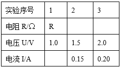
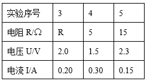

# Physics - 题目 2108

**ID**: 60fcf25ca5774767aef5830c7df2e3fc
**年级**: Grade 9
**难度**: Medium
**题型**: Experiment

## 题目
某实验小组在“探究电流大小与哪些因素有关”的实验中：(1)连接电路时，开关应，请用笔画线代替导线，根据如图甲将图乙所示的实物电路连接完整．(2)闭合开关前，图乙中滑动变阻器的滑片P应位于(选填“A”或“B”)端．(3)闭合开关后，发现电压表有示数，电流表无示数，则故障原因可能是．(4)排除故障后，通过实验得到的数据如表1所示，其中第1次实验的电流表示数如图丙所示，为A，根据表1中的数据，可得出结论：.​​​​​​​‌表1表2(5)实验小组继续探究电流与电阻的关系，将电阻R先后更换为5 Ω和15 Ω的电阻进行实验，得到的数据如表2所示，通过分析表2中的数据可知，实验小组在操作过程中存在的错误：.

## 解答

1. 解答：连接电路前，开关必须断开，避免在连接的过程因错误连接造成短路；根据电路图连接实物电路图，把电阻与滑动变阻器串联接入电路，电压表并联在电阻两端，电路图如图所示:
2. 
3. （2）连接电路前，滑动变阻器滑片要位于最大阻值处，应位于B，起到保护电路的作用；
4. （3）电流表没有示数，电压表有示数，说明电路是接通的，故可能的原因为电阻R断路，电压表接在电源两端，电压表示数等于电源电压；（4）由图丙所示电流表可知，其量程为0～0.6A，分度值为0.02A，示数为0.10A；由表中实验数据可知，在电阻一定时，通过导体的电流与导体两端的电压成正比；（5）更换电阻，电阻阻值变化，电阻两端电压变化，如果不调节滑动变阻器，不能控制电阻两端电压不变，因此不能得出电流与电阻成反比的结论；故操作错误为：没有移动滑动变阻器的滑片，使电阻两端的电压不变．

## 知识点

**中文**:
  - 电流与电压关系的探究实验
  - 电流与电阻关系的探究实验

**English**:
  - Experiment: Relationship between Current and Voltage
  - Experiment: Relationship between Current and Resistance

---
