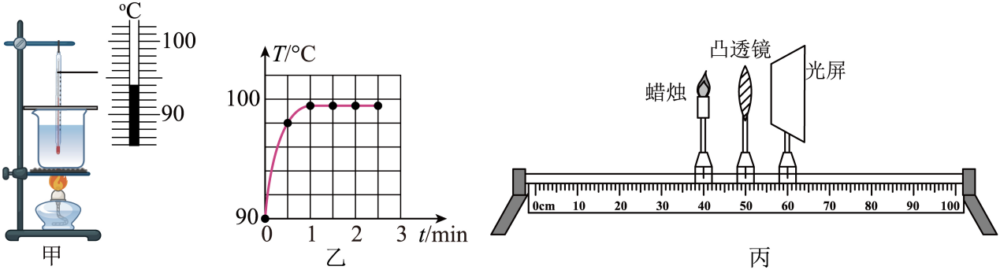

# Physics - 题目 1210

**ID**: 61ebdbb1a1f24b27a0892f416879e24b
**年级**: Grade 9
**难度**: Medium
**题型**: Experiment

## 题目
（1）小帅在探究水沸腾前后温度变化特点的实验中，安装烧杯和温度计时应先确定两者中的位置；图乙是水的温度随时间变化的关系图像，分析图像可知：水在沸腾过程中温度。​​​​​​​‌（2）小刚用焦距为10cm的凸透镜探究凸透镜成像的规律，当蜡烛、凸透镜、光屏三者高度如图丙所示时，适当调节的高度后便可开始实验；当蜡烛距凸透镜25cm时，移动光屏，在光屏上承接到一个清晰缩小的像，生活中的就是根据该成像规律制成的；把蜡烛适当靠近凸透镜，应将光屏（选填“靠近”或“远离”）凸透镜，才能再次承接到清晰的像。

## 解答

1. （1）酒精灯需用外焰加热，所以要先放好酒精灯，再固定铁圈的高度，而温度计的玻璃泡要全部浸没到液体中，但不能碰到容器壁和容器底，所以先放好烧杯后，再调节温度计的高度。由图像可知，水在沸腾时，温度保持不变。
2. （2）调整凸透镜、光屏、烛焰的中心大致在同一高度上，这样做的目的是使物体的像能够成在光屏的中心，如图所示，烛焰的中心位置过高，应适当向下调节。当 $u=25{\rm{c}}{\rm{m}}>2f$ 时，成倒立、缩小的实像，其应用是照相机。凸透镜成实像时的规律是：物近像远像变大。将烛焰向右移动靠近透镜，此时像距会变大，所以应将光屏向右移动远离透镜。

## 知识点

**中文**:
  - 凸透镜的成像规律
  - 探究水的沸腾实验

**English**:
  - Imaging Rules of Convex Lenses
  - Experiment: Boiling of Water

---
