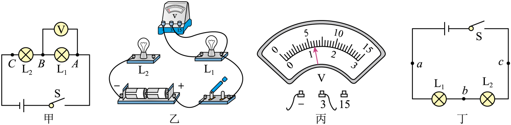

# Physics - 题目 816

**ID**: 63816244c1f247fd9cf6cf0ed1846be4
**年级**: Grade 9
**难度**: Medium
**题型**: Experiment

## 题目
探究串联电路中电压的规律：（1）根据图甲所示的电路图，用笔画线表示导线，将图乙所示的实物连接完整；（2）连接电路时，开关应处于状态；在连接电压表时，他们应采取的方法选取电压表的量程；正确连接电路后，闭合开关，若灯L_{2}断路，则灯L_{1}两端（选填“有”或“无”）电压；（3）用电压表分别测出AB、BC及AC之间的电压U_{AB}、U_{BC}和U_{AC}。​​​​​​​‌其中测U_{AB}时，电压表的示数如图丙所示，示数为V。接着更换不同规格的灯泡并进行多次实验，数据记录如下表：实验次序电压U_{AB}/V电压U_{BC}/V电压U_{AC}/V11.72.921.31.62.931.11.82.9①分析表中数据，得到初步结论：串联电路中电源两端的电压等于各用电器两端的电压；②为使结论更具普遍性，小明将灯泡换成其他类型用电器并进行多次实验；此外，还可以；（4）实验结束后，小华还想探究“串联电路的电流规律”，电路图如图丁所示，他测量了a、b、c三处的电流，分析数据并制成如下表格，发现三处的测量值有差异，下列分析正确的是；I_{a}/ AI_{b}/AI_{c}/ A0.160.160.14

## 解答

1. （1）根据电路图可知，两灯串联，电压表测量L_{1}两端的电压，即电压表并联在L_{1}两端。
2. （2）为防止电路连接过程出错而损坏电路元件，连接电路时，开关应断开。在无法确定合适的量程时，可以先选用大量程试触，再根据指针的偏转情况接入合适的量程。当L_{2}断路时，L_{1}与负极断开了，没有接入电路中，两端没有电压。
3. （3）如图所示，电压表的量程为0~3V，分度值为0.1V，读数为1.2V。
4. ①根据表格数据可知，AB段的电压与BC段的电压之和等于AC段的电压，即在串联电路中，总电压等于各部分的电压之和。
5. ②一次实验得出的结论具有偶然性，为了增加结论的普遍性，可以更换不同规格的灯泡重复上面的实验，也可以改变电源电压，多次测量。
6. （4）ACD．根据串联电路电流的规律，在串联电路中电流强度处处相等，表格中的差异可能是误差造成的，故A符合题意，CD不符合题意；
7. B．如果没有对电流表调零，则造成的偏差应均偏大或偏小，故B不符合题意。
8. （5）根据实验，小华得出串联电路的电流规律为在串联电路中，电流强度处处相等，即 $I{{}_{a}}=I{{}_{b}}=I{{}_{c}}$ 。

## 知识点

**中文**:
  - 探究串、并联电路中的电压规律实验

**English**:
  - Experiment: Voltage Laws in Series/Parallel

---
