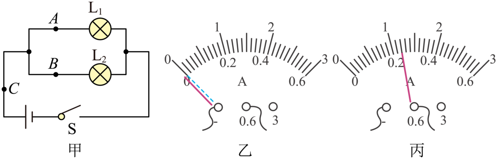

# Physics - 题目 2014

**ID**: 646060f4990d4764b603e820f0073282
**年级**: Grade 9
**难度**: Medium
**题型**: Experiment

## 题目
如图甲所示是小明在“探究并联电路电流的规律”实验中连接的电路图，请你帮他解决实验中遇到的以下问题。​​​​​​​‌（1）在连接电路时，开关应（选填“闭合”或“断开”），在连接电路前，发现电流表指针如图乙所示，则他应该将电流表；（2）他在测量B处的电流时，发现电流表的指针偏转又如图乙所示，原因是；在排除故障后，电流表的示数如图丙所示，则电流表的示数是A。（3）实验前最好选择两个灯泡的规格应该（选填“相同”或者“不同”），本实验多次测量的目的是。

## 解答

1. （1）为了保护电路，在连接电路时，开关应断开。如图乙，在连接电路时，指针就发生偏转，说明电流表指针未调零，因此应该将电流表校零。
2. （2）在测量B处的电流时，发现电流表的指针偏转又如图乙所示，即电流表指针反偏，说明电流表正负接线柱接反了。由图丙可知，电流表使用的小量程，分度值为0.02A，示数为0.24A。
3. （3）由于本实验是探究并联电路的电流规律，需要多次实验以寻找普遍规律，所以换用不同规格的灯泡进行多次实验，目的是使实验结论具有普遍性。

## 知识点

**中文**:
  - 探究串、并联电路的电流规律实验

**English**:
  - Experiment: Current Laws in Series/Parallel

---
