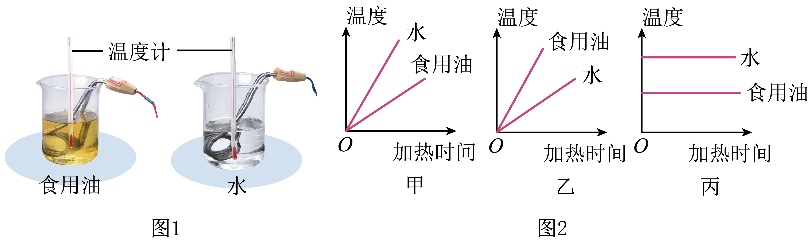

# Physics - 题目 631

**ID**: 6465a1c52a784985929d22ec493b6e15
**年级**: Grade 9
**难度**: Medium
**题型**: Experiment

## 题目
为了比较水和食用油的比热容，某同学用如图所示的器材进行了实验。​​​​​​​‌实验数据记录如下：物质质量/g初始温度/℃加热时间/min最后温度/℃水20020645食用油20020670（1）该实验除了图示中的实验器材以外，还需要的测量工具是停表和。（2）实验中，两烧杯内放入相同规格的电加热器，这样可以保证在相同的时间内，水和食用油吸收的热量，通过比较来比较水和食用油的吸热能力。（3）实验中用到的研究方法除了转换法外还有。（4）已知水的比热容为4.2×10^{3}J/（kg•℃），则食用油的比热容为J/（kg•℃）。（5）如图2中能合理反映该实验结果的图像是（填“甲”“乙”或“丙”）。

## 解答

1. （1）根据比较比较吸热能力的两种方法，要控制不同物质的质量相同，除停表外，还需要天平。
2. （2）实验中，两烧杯内放入相同规格的电加热器，根据转换法，这样可以保证在相同的时间内，水和食用油吸收的热量相同；根据比较吸热能力的第2种方法，通过比较升高的温度来比较水和食用油的吸热能力。
3. （3）实验中用到的研究方法除了转换法外还有控制变量法。
4. （4）由图可以看出，加热相同时间，水升高25℃，食用油升高50℃，根据 ${\rm{c}}=\frac {Q}{mΔt}$ ，在质量和吸热相同的情况下，比热容c与升高的温度成反比，则食用油的比热容为 $c=\frac {{{2}}{{5}}℃}{{{5}}{{0}}℃}\times {{4}}{{.}}{{2}}\times {{1}}{{0}}{^{{{3}}}}{\rm{J}}{\rm{/}}\left ({{\rm{k}}{\rm{g}}\cdot ℃}\right )={{2}}{{.}}{{1}}\times {{1}}{{0}}{^{{{3}}}}{\rm{J}}{\rm{/}}（{\rm{k}}{\rm{g}}\cdot ℃）$
5. （5）由表中数据，加热相同时间，水升温慢，如下所示：
6. 
7. 如图2中能合理反映该实验结果的图像是乙。

## 知识点

**中文**:
  - 物质的比热容探究实验

**English**:
  - Experiment: Investigating Specific Heat Capacity

---
