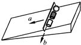

# Physics - 题目 1585

**ID**: 655b37d6d8f24e5b91567c8723870679
**年级**: Grade 9
**难度**: Medium
**题型**: Experiment

## 题目
小明同学想：物体从斜面的同一高度释放后滚动的快慢一样吗？他猜想物体滚动的快慢可能与物体的质量和形状有关．小明选择下列物品进行实验：一把米尺、一块塑料板、一个小球、同样规格的一只装满水的瓶子和一只空瓶子，如图所示．实验步骤如下：①用塑料板搭成一个倾斜角度较小的斜面．②将米尺横放在这块塑料板上，并握住它．③将小球、装满水的瓶子和空瓶子放在斜面上．④移走米尺，同时释放三个物体并观察它们滚动的快慢．请回答下列问题：(1)选取小球时应该注意的问题是．(2)下面关于移走米尺的两种方案，你认为较为合理的是(填“A”或“B”)．​​​​​​​‌

## 解答

1. （1）[1]由题知，物体滚动的快慢可能与物体的质量和形状有关，选取小球与瓶子做实验时，小球和瓶子的形状不同，是探究物体滚动的快慢与物体形状的关系，所以，选取小球时，应控制小球与某一个瓶子的质量相同；
2. （2）[2]若沿箭头b方向，快速将米尺移走，小球、装满水的瓶子和空瓶子开始运动的时间不同，会导致测量的结果误差太大；若沿箭头a方向，快速将米尺移走，小球、装满水的瓶子和空瓶子开始运动的时间基本相同，可以减小误差，故应选A；
3. （3）[3]在步骤④中，要判定物体滚动的快慢与物体的形状是否有关，可以观察小球和同质量的瓶子，看谁先到达底部，先到达底部的速度大，滚动块，后到达底部的速度小，滚动慢。

## 知识点

**中文**:
  - 速度变化的探究实验

**English**:
  - Experiment: Investigating Speed Change

---
