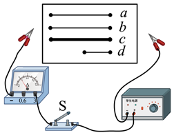

# Physics - 题目 2915

**ID**: 658905f7e48f49ee830ed8945286577e
**年级**: Grade 9
**难度**: Medium
**题型**: Experiment

## 题目
在探究“导体的电阻大小与哪些因素有关”时，某同学进行了如下实验。​​​​​​​‌如图所示，实验板上固定了四根金属丝。a、b、c长度相同，a、b、d横截面积相同，b、c、d材料相同。他分别将四根金属丝接入电路，记录的实验数据如下表所示。请回答下列问题：序号金属丝电流表示数/A1a0.72b0.33c0.64d0.6（1）该实验中，导体的电阻大小用电流表的示数来反映。这是采用了转换测量物理量的研究方法。以下选项中，同样采用了此种方法的是。（选填选项前的字母）

## 解答

1. （1）[1] A．借助水压学习电压，产生了类比的方法，将电流类比水流，电压类比水压，故A不符合题意；
2. B．借助磁感线来描述磁体周围的磁场，是借助物体模型来学习，将像光线一样，故B不符合题意；
3. C．电流做功无法看见，故可以借助电动机提升重物的高度反映电流做功多少，运用了转换法，故C符合题意；
4. D．研究电流与电压的关系时，保持导体电阻一定，采取了控制变量法，故D不符合题意。
5. 故选C。
6. （2）[2]a、b、c长度相同，a、b、d横截面积相同，b、c、d材料相同，而a、b电阻丝长度和横截面积相同，就材料不同，而电流表的示数不同，故探究的是电阻的大小与材料的关系。
7. （3）[3][4]根据3、4两组数据，即c、d两根电阻丝，仅仅是材料相同，长度不同，横截面积也不同，多个变量，无法得出结论，故结论是错误的，没有控制横截面积相同。

## 知识点

**中文**:
  - 影响导体电阻大小因素的探究实验

**English**:
  - Experiment: Factors Affecting Resistance

---
