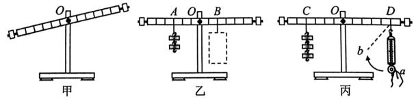

# Physics - 题目 2621

**ID**: 697851db4ea649f2b2e0788f7cbfc86b
**年级**: Grade 9
**难度**: Medium
**题型**: Experiment

## 题目
如图所示，是探究杠杆平衡条件的实验。​​​​​​​‌（1）挂钩码前，杠杆在如图甲所示的位置静止，此时杠杆（选填“是”或“不是”）平衡状态；为使杠杆在水平位置平衡，应将杠杆右端的平衡螺母向调节。（2）如图乙所示，A点挂有2个质量为50g的钩码，当在B点挂个质量为50g的钩码，能使杠杆在水平位置平衡。（3）实验中需要改变实验条件，测量多组杠杆平衡时的动力、动力臂、阻力和阻力臂的数据，目的是。（4）如图丙所示，在C点悬挂3个质量为50g的钩码，在D点用弹簧测力计竖直向下拉，使杠杆在水平位置再次平衡，则拉力大小为N。若保持杠杆平衡状态不变，将弹簧测力计由a方向缓慢转动到b方向的过程中，其示数将（选填“变大”、“变小”或“不变”）。如果测力计的量程为0~5N，保持支点O、悬挂点D位置不变，利用图丙中的杠杆能较为准确地测出的最大物体质量为g（g取10N/kg）。

## 解答

1. （1） 平衡状态是指处于静止或匀速直线运动状态的物体，杠杆保持静止，此时杠杆处于静止状态，是平衡状态。
2. 如图甲所示，杠杆左端下沉，其左端偏高，说明杠杆左侧偏重，应将平衡螺母向右端移动，使杠杆在水平位置平衡。
3. （2） 设杠杆每个格的长度为l，每个钩码的重力为G，根据杠杆的平衡条件F_{1}l_{1}=F_{2}l_{2}可得 $2G\times 3l=F{{}_{B}}\times 2l$ ，解得FB=3G，应在B点挂3个质量均为50g的钩码。
4. （3） 实验中需要改变实验条件，测量多组杠杆平衡时的动力、动力臂、阻力和阻力臂的数据，目的是为了使实验的结论具有普遍性，避免偶然性。
5. （4） 根据杠杆的平衡条件 $3G\times 4l=F\times 5l$ ，得 $F=\frac {12\times 50\times 10{^{-3}}\times 10}{5}{\rm{N}}{\rm{=}}{\rm{1}}{\rm{.}}{\rm{2}}{\rm{N}}$
6. 让杠杆在水平位置平衡，将弹簧测力计斜向左拉，阻力和阻力臂不变，拉力的力臂变短，根据杠杆平衡条件可知，杠杆在水平位置平衡时，拉力变大，所测力计的示变大。
7. 弹簧测力计的量程为0～5N，当拉力等于5N，并竖直向下拉时，拉起物体的重力最大，则有 $G{^{^{′}}}\times L{{}_{左}}=F{^{^{′}}}\times L{{}_{右}}$ ，代入数据得 $G{^{^{′}}}\times L=5{\rm{N}}\times 5L$ ，解得 $G{^{^{′}}}=25{\rm{N}}$ ，由G=mg得 $m=\frac {G{^{^{′}}}}{g}=\frac {25{\rm{N}}}{10{\rm{N}}{\rm{/}}{\rm{k}}{\rm{g}}}=2.5{\rm{k}}{\rm{g}}=2500{\rm{g}}$

## 知识点

**中文**:
  - 探究杠杆的平衡条件实验

**English**:
  - Experiment: Equilibrium Conditions of Levers

---
