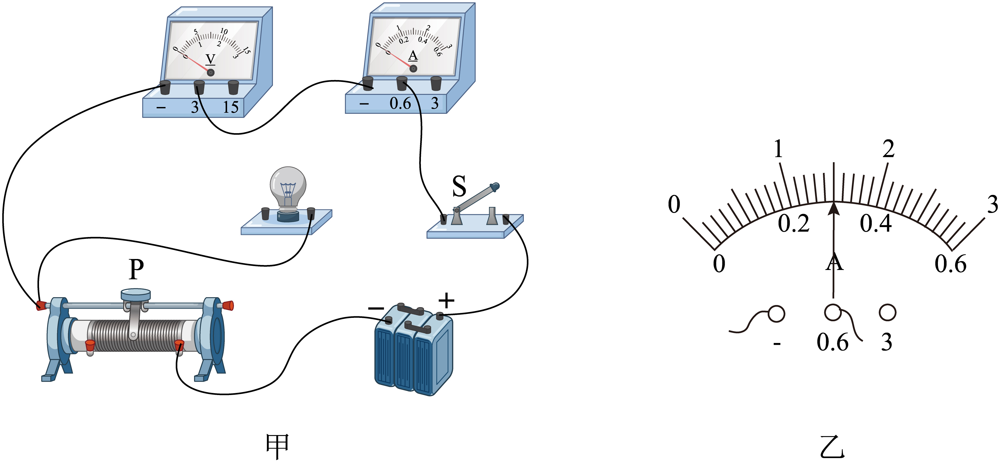

# Physics - 题目 2756

**ID**: 6a119c48593b468fa66e954475d12328
**年级**: Grade 9
**难度**: Medium
**题型**: Experiment

## 题目
如图所示，在“测量小灯泡的电功率”的实验中，小灯泡的额定电压为2.5V，电阻大约为10Ω，电源电压为6V恒定不变。​​​​​​​‌（1）如图甲所示的电路中还有一根导线没有连接，请用笔画线代替导线，将电路连接完整（要求：导线不得交叉）；（2）电路连接好且检查无误后，闭合开关，移动滑动变阻器的滑片P，使电压表示数为2.5V，小灯泡正常发光，此时电流表示数如图乙所示，则小灯泡的额定功率为W；实验次数小灯泡两端的电压U/V通过小灯泡的电流I/A小灯泡的亮度小灯泡的电功率P/W12.20.28比正常发光暗0.6222.5正常发光32.80.32比正常发光亮0.90（3）继续进行实验，并把实验数据填写在上表中，对表格进行分析，发现小灯泡亮度是变化的，小灯泡的亮度是由其（选填“实际功率”或“额定功率”）决定的；（4）观察表中的数据发现，虽然是同一小灯泡，但通过小灯泡的电流与其两端的电压并不成正比，其原因是。

## 解答

1. （1）测量小灯泡的电功率，滑动变阻器、灯泡、电流表串联在电路中，电压表与灯泡并联。应把电压表“3”接线柱与灯泡左侧接线柱连接起来，如图所示：
2. 
3. （2）由图乙可知，电流表选用的是小量程，分度值为0.02A，示数为0.3A，则小灯泡的额定功率为P=UI=2.5V×0.3A=0.75W
4. （3）小灯泡的额定功率是固定不变的，分析表格中数据可知，实际电压越大，小灯泡的实际功率越大，小灯泡越亮，所以小灯泡的亮度是由其实际功率决定的。
5. （4）当电阻一定时，通过导体的电流与导体两端的电压成正比。但小灯泡的电阻随灯丝温度的变化而变化，所以通过小灯泡的电流与其两端的电压并不成正比。

## 知识点

**中文**:
  - 伏安法测量小灯泡的电功率

**English**:
  - Measuring Bulb Power (Voltammetry)

---
