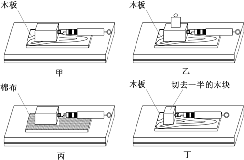

# Physics - 题目 982

**ID**: 6d4c4f7ade4543ffb8bab581283c33b7
**年级**: Grade 9
**难度**: Medium
**题型**: Experiment

## 题目
小伟在“探究影响滑动摩擦力大小的因素”的实验中，他猜想影响滑动摩擦力的大小因素可能与：①接触面所受的压力大小；②接触面的粗糙程度；③接触面积的大小有关。​​​​​​​‌接着小明就通过如图所示实验操来验证他的猜想：（1）实验中小伟用弹簧测力计水平匀速直线拉动木块在长木板上滑动，这样做是为了利用的原理得出拉力等于摩擦力，从而测出木块所受摩擦力的大小。（2）如果小伟要探究猜想②，他应该选择两幅图所示的实验步骤来操作，根据图中弹簧测力计的示数可得出结论：在其他因素相同的情况下，，滑动摩擦力越大。（3）小伟要探究猜想③，他将木块切去一半，重复甲的操作过程，如图丁所示．他比较甲和丁的实验结果，得出结论：滑动摩擦力的大小与接触面积的大小有关。那么小伟在实验中存在的问题是。

## 解答

1. (1)[1]实验中小伟应该用弹簧测力计水平匀速直线拉动木块在长木板上滑动，这时拉力和摩擦力是一对平衡力，处于二力平衡状态，摩擦力等于拉力。
2. (2)[2]要探究摩擦力大小与接触面的粗糙程度的关系，根据控制变量法及猜想需使压力大小和接触面积大小相同，改变接触面的粗糙程度，所以应选择甲图和丙图。
3. [3]由图知，在其他因素相同的情况下，接触面越粗糙，滑动摩擦力越大。
4. (3)[4]要探究摩擦力大小与接触面积的大小的关系，由控制变量法及猜想需使压力大小和接触面的粗糙程度相同，改变接触面积的大小，而小伟将木块切去一半，则在接触面积变化的同时，压力也发生了变化，所以得出错误结论。

## 知识点

**中文**:
  - 影响滑动摩擦力大小因素的探究实验

**English**:
  - Experiment: Factors Affecting Sliding Friction

---
