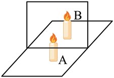

# Physics - 题目 1604

**ID**: 6ea1d6b31c714c6eb8264f1feb582511
**年级**: Grade 9
**难度**: Medium
**题型**: Experiment

## 题目
某兴趣小组为了验证“人在平面镜中所成的像“近大远小”这个观点是否正确，找来了玻璃板、两只完全相同的蜡烛A和B、白纸、刻度尺、火柴等器材。​​​​​​​‌（1）探究过程如下：①如图所示，在桌面上铺一张大白纸，纸上竖立一块玻璃板作为平面镜。沿着玻璃板在纸上画一条直线，代表平面镜的位置；②将点燃的蜡烛A放在玻璃板前，在玻璃板后移动未点燃的蜡烛B，发现在某一位置蜡烛B与蜡烛A的像能够完全重合，在白纸上标记蜡烛A和B的位置；③改变蜡烛A的位置，在玻璃板后移动蜡烛B，始终能找到与蜡烛A的像完全重合的位置，标记蜡烛A和B的位置；④在蜡烛所成像的位置放一张白纸，发现白纸上不能得到蜡烛的像；⑤用刻度尺分别测量蜡烛A和B到玻璃板的距离数据记录如表2。表2次数蜡烛A到玻璃板的距离/cm蜡烛A的像到玻璃板的距离/cm蜡烛的像与蜡烛的大小关系15.025.01相等210.0210.02相等315.0115.00相等（2）分析了表2的实验数据，得到以下结论：①像到平面镜的距离和物体到平面镜的距离；②平面镜所成像的大小与物体到平面镜的距离（选填“有关”或“无关”），说明“人在平面镜中所成的像近大远小”的观点是错误的；③平面镜所成的像是（选填“实像”或“虚像”）。（3）为了保证实验效果，做这个实验时应选择较（选填“厚”或“薄”）的玻璃板。

## 解答

1. （2）①[1]由表2数据可知，第一次实验蜡烛A和蜡烛A的像到玻璃板的距离分别为5.02cm、5.01cm，，第三次实蜡烛A和蜡烛A的像到玻璃板的距离分别为15.01cm、15.00cm，只是估读不同，属于误差；第二次实验蜡烛A到玻璃板的距离为10.02cm，蜡烛A的像到玻璃板的距离为10.02cm。综上所述，得到结论：像到平面镜的距离和物体到平面镜的距离相等。
2. ②[2]由表2可知，蜡烛到平面镜的距离不同，但所成蜡烛的像大小与蜡烛的大小相等，由此可知，平面镜所成像的大小与物体到平面镜的距离无关。
3. ③[3]由探究过程④可知，在蜡烛所成像的位置放一张白纸，发现白纸上不能得到蜡烛的像，白纸相当于光屏，即在光屏只能承接实像，不能承接虚像，故平面镜所成的像是虚像。
4. （3）[4]玻璃板有两个反射面，每个反射面相当于一个平面镜，都可以成像，选用薄玻璃板，两个像的距离近，测量误差小，实验效果好；反之选用厚玻璃板，两个像的距离较远，会出现两个不重合的像，从而影响实验效果。所以为了保证实验效果，做这个实验时应选择较薄的玻璃板实验。

## 知识点

**中文**:
  - 平面镜成像特点的探究实验

**English**:
  - Experiment: Characteristics of Plane Mirror Imaging

---
