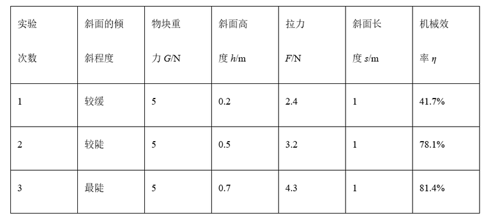

# Physics - 题目 2243

**ID**: 6f7250ea38774bcb9c3b2c1f73f192e0
**年级**: Grade 9
**难度**: Medium
**题型**: Experiment

## 题目
对“斜面的机械效率与什么因素有关”这一课题，小明提出了如下一些值得探究的猜想：①斜面的机械效率与斜面的倾斜程度有关；②斜面的机械效率与斜面的粗糙程度有关；③斜面的机械效率与斜面的长度有关；④斜面的机械效率与物体的重力有关。​​​​​​​‌如图所示，小明用弹簧测力计沿同一斜面匀速向上拉动物块，收集了下表中的实验数据。(1)小明探究的是猜想（填序号）。分析表中的数据可得出：在其他条件一定时，斜面越缓越（选填“省”或“费”）力；斜面越陡，机械效率越（选填“高”或“低”）。(2)小明又进行了第4次实验，他在斜面上铺上棉布，使斜面变粗糙，保持斜面高和长分别是0.5m和1m，用弹簧测力计拉动同一物块沿斜面向上做匀速直线运动，读出此时弹簧测力计的示数为4.5N，小明测得这种情况下斜面的机械效率为（保留一位小数），把第4次与第次测量结果相比较，还能得出：在其他条件一定时，斜面越粗糙，斜面的机械效率越低。(3)当用弹簧测力计沿斜面匀速向上拉动物块时，物块所受的拉力（选填“大于”“小于”或“等于”）物块所受的摩擦力。

## 解答

1. (1)[1]小明用弹簧测力计沿同一斜面匀速向上拉动物块，斜面的粗糙程度相同，由表格数据可知，物体重力相同，斜面的倾斜程度不同，故研究的是斜面的机械效率与斜面的倾斜程度的关系，即选择①。
2. [2][3]分析实验3、2、1的数据可知，在其它条件一定时，斜面越缓，拉力越小，即越省力；分析实验1、2、3的数据可知，斜面越陡，机械效率越高。
3. (2)[4]第4次实验中，斜面的机械效率为
4. $η=\frac {W{{}_{有用}}}{W{{}_{总}}}\times 100\%=\frac {Gh}{Fs}\times 100\%=\frac {5{\rm{N}}\times 0.5{\rm{m}}}{{\rm{4}}{\rm{.}}{\rm{5}}{\rm{N}}\times 1{\rm{m}}}\times 100\%\approx 55.6\%$
5. [5]要研究斜面机械效率与粗糙程度的关系，应控制变量，控制粗糙程度不同，倾斜程度等因素相同，故第4次应与第2次测量结果相比较。
6. (3)[6]实验过程中，沿斜面匀速向上拉动物块时，测力计的拉力F要同时克服摩擦力f和物体的一部分重力，所以f<F。

## 知识点

**中文**:
  - 斜面机械效率的测量实验

**English**:
  - Experiment: Measuring Mechanical Efficiency of Inclined Planes

---
