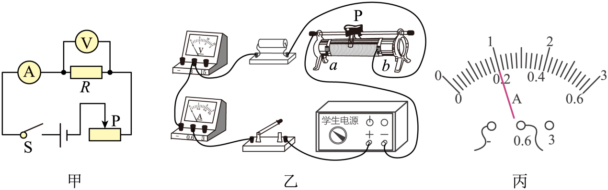

# Physics - 题目 270

**ID**: 7200d482c863400c98b5a0f8c81e4c4c
**年级**: Grade 9
**难度**: Medium
**题型**: Experiment

## 题目
实验室有一个铭牌模糊不清的定值电阻，小明设计如图甲所示的电路图，用“伏安法”测定值电阻的阻值，电源电压恒为3V。​​​​​​​‌（1）请根据图甲用笔画线代替导线，将图乙所示的实物电路连接完整（导线不允许交叉）；（2）在连接电路时，滑动变阻器的滑片应移动到（选填“a”或“b”）端；（3）实验中闭合开关后，发现电流表没有示数，电压表有示数且指针偏转较大，则存在的电路故障可能是（选填“电流表断路”、“定值电阻短路”或“定值电阻断路”）（4）排除故降后，移动滑动变阻器的滑片，读出了四组实验数据，第1次实验时电流表读数如图丙所示，此时电流表示数为A；次数1234U/V0.81.21.61.9I/A0.340.440.50（5）多次测量求电阻的平均值，定值电阻的阻值Ω；（6）小明提议，将电路中定值电阻换为小灯泡可以用于测量小灯泡电阻，为了减小实验误差，应多次测量求取小灯泡电阻的平均值。你认为小明的提议是（选填“正确”或“错误”）的，理由是。

## 解答

1. （1）由于电源电压为3V，所以电压表选用0~3V的量程与定值电阻并联，作图如下：
2. 
3. （2）为了保护电路，在连接电路时，滑动变阻器的滑片应移动到阻值最大的a端。
4. （3）电流表无示数，说明电路可能存在断路；电压表有示数且指针偏转较大，说明电压表与电源连通，则与电压表并联的电路以外的电路是完好的，与电压表并联的定值电阻断路。
5. （4）由图丙可知，电流表接的是小量程，分度值为0.02A，所以第1次实验时电流表读数为0.20A。
6. （5）根据表格数据，计算出四次实验的电阻分别为 $R{{}_{1}}=\frac {U{{}_{1}}}{I{{}_{1}}}=\frac {0.8{\rm{V}}}{0.20{\rm{A}}}=4Ω$ ， $R{{}_{2}}=\frac {U{{}_{2}}}{I{{}_{2}}}=\frac {{{1}}{{.}}{{2}}{\rm{V}}}{0.34{\rm{A}}}\approx 3.5Ω$ ， $R{{}_{3}}=\frac {U{{}_{3}}}{I{{}_{3}}}=\frac {{{1}}{{.}}{{6}}{\rm{V}}}{{{0}}{{.}}{{4}}{{4}}{\rm{A}}}\approx 3.6Ω$ ， $R{{}_{4}}=\frac {U{{}_{4}}}{I{{}_{4}}}=\frac {{{1}}{{.}}{{9}}{\rm{V}}}{0.50{\rm{A}}}=3.8Ω$ ，多次测量求得电阻的平均值为 $R=\frac {4Ω+3.5Ω+3.6Ω+3.8Ω}{4}\approx 3.7Ω$ ，定值电阻的阻值越为3.7Ω。
7. （6）由于灯的电阻随温度的变化而变化，所以多次测量求取小灯泡电阻的平均值是没有意义的，所以小明的提议错误的。

## 知识点

**中文**:
  - 伏安法测电阻的探究实验

**English**:
  - Experiment: Measuring Resistance (Voltammetry)

---
