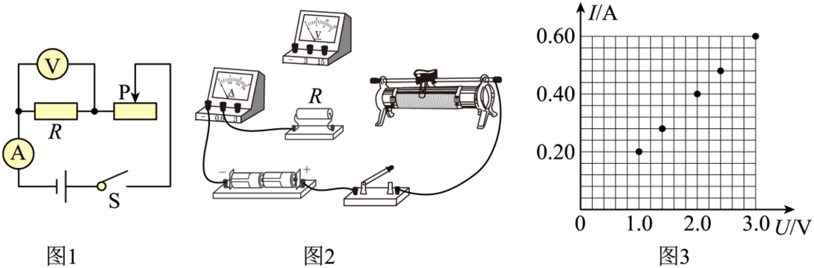

# Physics - 题目 2387

**ID**: 74586f57330e4044b1c43820a0eccc15
**年级**: Grade 9
**难度**: Medium
**题型**: Experiment

## 题目
小金同学利用“伏安法”测电阻。​​​​​​​‌（1）请你根据小金设计的图1的电路图，用笔画线代替导线将图2的实物图连接完整；（2）实验前，滑动变阻器的滑片P应置于最（选填“左”或“右”）端；（3）实验中测得多组实验数据。其中5组数据对应的点已描在图3中，请在图3中画出R的 $I-U$ 图象。由图可得， $R=$$Ω$ 。

## 解答

1. （1）由电路图可知，定值电阻与滑动变阻器串联，电压表并联在定值电阻两端，电流表串联在电路中，因为电源电压为3V，所以电压表量程选择0～3V，电流表量程选择0～0.6A，滑动变阻器按“一上一下”的原则串联在电路中，滑片向右滑动时接入电路中的阻值变大，故将左下接线柱接入电路，实物电路图的连接如图所示：
2. 
3. （2）为保护电路，闭合开关前，滑动变阻器的滑片应处于最大阻值处，即最右端。
4. （3）根据描出的点，利用平滑的曲线连接各点即为电阻的I−U图象如图所示：
5. 
6. 由图象可知，当U=3V时，I=0.6A，则定值电阻的阻值 $R=\frac {U}{I}=\frac {3{\rm{V}}}{0.6{\rm{A}}}=5{\rm{Ω}}$ 。

## 知识点

**中文**:
  - 伏安法测电阻的探究实验

**English**:
  - Experiment: Measuring Resistance (Voltammetry)

---
