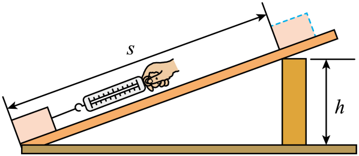

# Physics - 题目 2771

**ID**: 76873eca5902442ba9d34d3f4393757c
**年级**: Grade 9
**难度**: Medium
**题型**: Experiment

## 题目
下表是李明用图所示装置探究斜面机械效率的实验数据。​​​​​​​‌实验次数物块重力G/N斜面高度h/m沿斜面拉力F/N斜面长s/m机械效率140.32160%280.3413120.36160%480.45164%580.55.6171.4%（1）在第2次实验中，斜面的机械效率为，物块与斜面间的摩擦力为N；（2）实验1、2、3是探究斜面机械效率与的关系。由表中数据可知，当斜面粗糙程度和倾斜程度不变时，沿斜面向上均匀拉动不同重力的物体，机械效率（填“变大”、“变小”或“不变”）；（3）实验是探究斜面机械效率与斜面倾斜角度的关系。由表中数据可知，在斜面粗糙程度相同时，斜面越陡，机械效率。

## 解答

1. （1）在第2次实验中，总功为 $W{{}_{总}}=Fs=4{\rm{N}}\times 1{\rm{m}}=4{\rm{J}}$ ，有用功
2. $W{{}_{有用}}=Gh=8{\rm{N}}\times 0.3{\rm{m}}=2.4{\rm{J}}$ ，斜面的机械效率为 $η=\frac {W{{}_{有用}}}{W{{}_{总}}}=\frac {2.4{\rm{J}}}{4{\rm{J}}}\times 100\%=60\%$ ，克服斜面摩擦做的额外功 $W{{}_{额}}=W{{}_{总}}-W{{}_{有用}}=4{\rm{J}}-2.4{\rm{J}}=1.6{\rm{J}}$ ，由 $W{{}_{额}}=fs$ 可得，物块与斜面间的摩擦力为 $f=\frac {W{{}_{额}}}{s}=\frac {1.6{\rm{J}}}{1{\rm{m}}}=1.6{\rm{N}}$
3. （2）在第1、2、3次实验中，斜面的高度、长度均相同，即斜面的倾斜角度相同，但物块的重力不同，故实验1、2、3是探究斜面机械效率与物块重力的关系。
4. 由表中数据可知，当斜面粗糙程度和倾斜角度不变时，沿斜面向上均匀拉动不同重力的物体，机械效率不变。
5. （3）第2、4、5次实验中，物块的重力相同，斜面的长度相同，但斜面的高度不同，即斜面的倾斜角度不同，故实验2、4、5是探究斜面机械效率与斜面倾斜角度的关系，由表中数据可知，在斜面粗糙程度相同时，斜面越陡，机械效率越高。

## 知识点

**中文**:
  - 斜面机械效率的测量实验

**English**:
  - Experiment: Measuring Mechanical Efficiency of Inclined Planes

---
