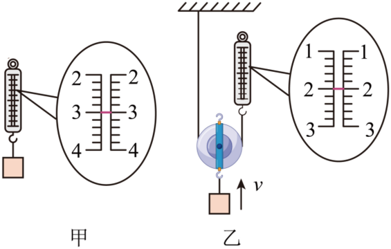

# Physics - 题目 101

**ID**: 795ad0ca25ba4106aa3e4c573ab821b6
**年级**: Grade 9
**难度**: Medium
**题型**: Experiment

## 题目
在“探究动滑轮特点的实验”中，实验过程如下：（1）如图甲所示，测量前，保持弹簧测力计竖直并调节指针对准。​​​​​​​‌随后在其挂钩上悬挂物体，待示数稳定后可得出物体的重力 $G=$N；（2）将细线的一端固定于天花板，另一端绕过滑轮与测力计挂钩相连，如图乙所示，要使物体上升，则测力计的移动方向为，对比定滑轮的特点可说明使用动滑轮；（3）当物体匀速向上运动时，测力计的示数图乙所示，对比两图中测力计的示数可知，使用动滑轮的优点是。

## 解答

1. （1）测量物体重力前，使弹簧测力计竖直并调节指针对准零刻度线。
2. 测量物体重力时，当物体静止时，物体受到的重力与弹簧测力计的拉力是一对平衡力，大小相等；测力计的最小刻度的分度值为0.2N，示数为3N，所以物体的重力G=3N。
3. （2）如图乙所示，要使物体上升，则测力计的移动方向为竖直向上，由于物体移动方向与拉力的方向相同，所以可说明使用动滑轮不能改变力的方向。
4. （3）在图乙中，拉力F=2N＜G=3N，故使用动滑轮时省力。

## 知识点

**中文**:
  - 探究动滑轮特点的实验

**English**:
  - Experiment: Characteristics of Movable Pulleys

---
